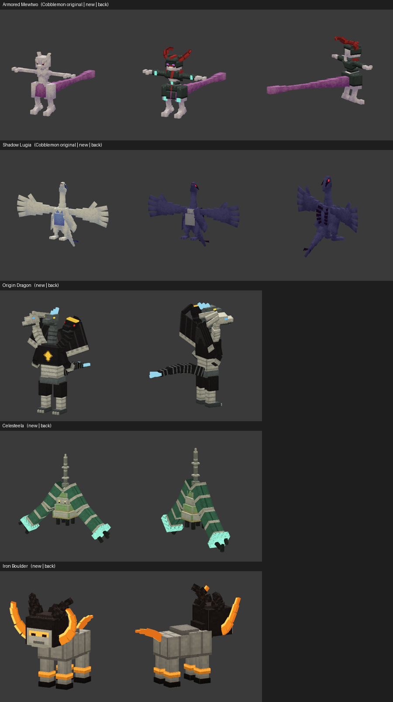

# CobbleEffort

A Cobblemon sidemod that adds **extra cosmetic forms** for existing Cobblemon models, in the spirit of
[CobblemonMoreCosmetics](https://modrinth.com/resourcepack/cobblemonmorecosmetics). It changes no models:
each form is a new texture applied through Cobblemon's own cosmetic-slot and aspect system.

**Collections so far:** #1 Backrooms (40 Pokémon) · #2 Thanksgiving (37 Pokémon) · #3 Halloween (33 Pokémon) · #4 Christmas (40 Pokémon) · #5 Easter (38 Pokémon) · plus **new Pokémon & forms**: Armored Mewtwo, Shadow Lugia, Origin Dragon, Celesteela, Iron Boulder.

**House rule: every cosmetic covers whole evolutionary lines.** If one stage gets a form, every pre-evolution,
evolution and branch of that Pokémon gets it too. The generator enforces this (see [Collection rules](#collection-rules)).

## Collection #1: Backrooms (Still Lifes)

18 evolutionary lines (**40 Pokémon**) re-imagined as **Still Lifes** from Kane Pixels' *Backrooms*. A Still Life is an imperfect
copy of something real that the Backrooms rebuilt from memory. Here that means:

* colour drained into a sallow **plaster / wet-clay** palette, lit by Level 0's mono-yellow fluorescent light
* **damp blotches**, clay grain and wobbly **seams** where the "pieces" were pressed together
* rows that **slipped sideways**, like a bad copy
* **matte painted-on eyes** with a second, misplaced set just below and a **smear** running down from them
* no glow: emissive layers (Magnezone, Sizzlipede, Centiskorch, Nymble, Lokix) are switched off

Shiny Pokémon get their own Still Life, built from the shiny texture so a faint trace of the shiny colour shows through.


| Line | Pokémon |
|------|---------|
| Magnemite | Magnemite → Magneton → Magnezone |
| Omanyte | Omanyte → Omastar |
| Nincada | Nincada → Ninjask / Shedinja |
| Torkoal | Torkoal |
| Anorith | Anorith → Armaldo |
| Snorunt | Snorunt → Glalie / Froslass |
| Piplup | Piplup → Prinplup → Empoleon |
| Blitzle | Blitzle → Zebstrika |
| Shelmet | Shelmet → Accelgor |
| Fletchling | Fletchling → Fletchinder → Talonflame |
| Swirlix | Swirlix → Slurpuff |
| Amaura | Amaura → Aurorus |
| Xerneas | Xerneas |
| Silicobra | Silicobra → Sandaconda |
| Sizzlipede | Sizzlipede → Centiskorch |
| Impidimp | Impidimp → Morgrem → Grimmsnarl |
| Nymble | Nymble → Lokix |
| Maschiff | Maschiff → Mabosstiff |

The 18 lines were picked at random (`random.Random("kane-pixels-level-0").sample(...)`) and then expanded to
their full evolutionary families from Cobblemon's species data. Torkoal and Xerneas have no evolutions.

### How to get one

**Cosmetic slot (survival):** give a supported Pokémon one **Yellow Carpet** (Level 0's damp carpet) as its
*cosmetic item*, the same way you would put any Cobblemon cosmetic on it (open your Pokémon's interaction
menu while holding the carpet and choose the cosmetic slot). Take the carpet back to undo it.

**Commands (testing / servers):** the form is also a species feature, so it works anywhere Pokémon properties do:

```
/pokegive magnemite backrooms
/pokegive glalie backrooms shiny
/spawnpokemon slurpuff backrooms
```

**Pack makers:** the accepted items come from the item tag `#cobbleeffort:backrooms_cosmetics`. Add items to it
with a datapack (`data/cobbleeffort/tags/item/backrooms_cosmetics.json`).

## Collection #2: Thanksgiving (Harvest)

18 more evolutionary lines (**37 Pokémon**) dressed for a Thanksgiving table:

* colours moved onto a **harvest palette** that keeps the original markings readable: deep reds become cranberry,
  pinks peach, oranges pumpkin, yellows maize gold, greens sage, blues and cyans chestnut and toasted squash,
  purples plum
* greys, whites and blacks turned into warm neutrals: **pie-crust cream, cinnamon, dark roast**
* a golden-brown **roast glaze** along the edges of each painted area
* a few **fallen maple leaves** (pumpkin, amber, gold) stuck to the fur
* **eyes keep their original colours**, so every Pokémon still looks like itself
* **shiny → golden harvest**: everything pulled toward honey-gold
* glowing parts keep glowing, recoloured like candlelight


| Line | Pokémon |
|------|---------|
| Squirtle | Squirtle → Wartortle → Blastoise |
| Meowth | Meowth (incl. Alolan & Galarian) → Persian / Perrserker |
| Porygon | Porygon → Porygon2 → Porygon-Z |
| Corsola | Corsola (incl. Galarian) → Cursola |
| Miltank | Miltank |
| Kecleon | Kecleon |
| Bagon | Bagon → Shelgon → Salamence |
| Croagunk | Croagunk → Toxicroak |
| Carnivine | Carnivine |
| Munna | Munna → Musharna |
| Tirtouga | Tirtouga → Carracosta |
| Ferroseed | Ferroseed → Ferrothorn |
| Mienfoo | Mienfoo → Mienshao |
| Grubbin | Grubbin → Charjabug → Vikavolt |
| Bounsweet | Bounsweet → Steenee → Tsareena |
| Pyukumuku | Pyukumuku |
| Squawkabilly | Squawkabilly (all four plumages) |
| Wiglett | Wiglett → Wugtrio |

Picked with `generate.py pick --count 18 --seed thanksgiving-2026`: 18 random lines out of the 417 that are fully
modelled in Cobblemon and not already in another collection.

### How to get one

Give a supported Pokémon one **Pumpkin Pie** as its cosmetic item. With commands: `/pokegive miltank thanksgiving`,
`/pokegive squirtle thanksgiving shiny`. Pack makers can extend the item tag `#cobbleeffort:thanksgiving_cosmetics`.

## Collection #3: Halloween (Nightmare) ⚠️ gore

> **Content warning:** this collection is deliberately horrific. It has blood, gore, rotting flesh, wounds and
> body horror. Players who don't want it simply never use the Carved Pumpkin cosmetic.

18 evolutionary lines (**33 Pokémon**) turned into nightmares. These are **animated textures** (4 frames, 5 fps):

* colour drained and darkened, mottled with **bruise-purple and rot-green**, grime along every edge
* swollen **bruised lumps**, **torn patches of raw flesh**, some crudely **stitched** shut
* **blood splatters** with drips running down, and a drop that creeps further each frame
* **lots of extra, misplaced eyes**: bloodshot, with darting pupils, some blinking, some weeping blood
* the Pokémon's own eyes turn blood red, and **misplaced copies** of them grow elsewhere on the body
* **mouths full of jagged, yellowed, bloody teeth that gnash** open and shut
* shiny → **pale corpse**: cold grey-blue skin, so the blood stands out more
* glowing parts become a sickly **ghost-green**. Full-body glow layers (Shinx line) keep only their hottest spots,
  so they don't hide the gore

**Charmander line ("Bone-Rot"):** Charmander, Charmeleon and Charizard are **skeletons with flesh rotting off the
bones**: cracked ivory bone, an exposed **rib cage** where the belly was, ragged rotting flesh with blood, ichor and
maggots, hollow eye sockets with a flickering pink ember, a gnashing skeletal grin, and the tail fire burning
**pink**. Shiny Charmanders have charred black bones.


| Line | Pokémon |
|------|---------|
| **Charmander** (Bone-Rot) | Charmander → Charmeleon → Charizard |
| Koffing | Koffing → Weezing (incl. Galarian) |
| Sentret | Sentret → Furret |
| Misdreavus | Misdreavus → Mismagius |
| Absol | Absol |
| Shinx | Shinx → Luxio → Luxray |
| Glameow | Glameow → Purugly |
| Timburr | Timburr → Gurdurr → Conkeldurr |
| Sigilyph | Sigilyph |
| Ducklett | Ducklett → Swanna |
| Pancham | Pancham → Pangoro |
| Comfey | Comfey |
| Komala | Komala |
| Dracovish | Dracovish |
| Tarountula | Tarountula → Spidops |
| Nacli | Nacli → Naclstack → Garganacl |
| Klawf | Klawf |
| Veluza | Veluza |

The Charmander line was chosen by request. The other 17 were picked with
`generate.py pick --count 17 --seed halloween-2026` from the 398 remaining eligible lines.

Models aren't changed (this mod only retextures). The deformities, extra eyes and mouths are painted onto the
existing models.

### How to get one

Give a supported Pokémon a **Carved Pumpkin** as its cosmetic item. With commands: `/pokegive charmander halloween`,
`/pokegive tarountula halloween shiny`. Pack makers can extend the item tag `#cobbleeffort:halloween_cosmetics`.

## Collection #4: Christmas

18 evolutionary lines (**40 Pokémon**). Four of them have their own costume:

| Line | Look |
|------|------|
| **Munchlax → Snorlax** | **Santa Claus**: red suit, a red coat front with white fur trim, a black belt with a gold buckle, and a white fluffy beard and cuffs. Shiny: an old-world **Father Christmas** in green |
| **Turtwig → Grotle → Torterra** | **Christmas tree**: every leafy part becomes a pine tree hung with baubles and gold tinsel, wound with **twinkling fairy lights**, and topped with snow. Shiny: a white **flocked** tree |
| **Trubbish → Garbodor** | **Christmas gift**: wrapped in candy-stripe paper with a green satin ribbon, a bow and a gift tag. Shiny: gold foil with a red ribbon |
| **Phantump → Trevenant** | **Krampus**: shaggy black goat fur, ridged ram's horns, **red eyes that glow in the dark**, a long red tongue, and iron chains hung with gold bells. Shiny: a white-furred Krampus with gold horns |

The other 14 lines get the **Festive** look: a Christmas palette (crimson, gold, pine, icy blue, berry, with snowy
whites), snow settled on top of every surface, snowflakes, and strings of **fairy lights that glow in the dark and
twinkle**. Shiny: **Frosted** (silver, ice and snow).

Weedle → Kakuna → Beedrill · Mankey → Primeape → Annihilape · Shellder → Cloyster · Girafarig → Farigiraf ·
Pineco → Forretress · Heracross · Makuhita → Hariyama · Spiritomb · Skorupi → Drapion ·
Sewaddle → Swadloon → Leavanny · Yamask (incl. Galarian) → Cofagrigus / Runerigus · Larvesta → Volcarona ·
Litleo → Pyroar · Dreepy → Drakloak → Dragapult

The four costume lines were chosen by request; the other 14 were picked with
`generate.py pick --count 14 --seed christmas-2026` from the 377 remaining eligible lines.


### How to get one

Give a supported Pokémon a **Snowball** as its cosmetic item. With commands: `/pokegive snorlax christmas`,
`/pokegive turtwig christmas shiny`. Pack makers can extend the item tag `#cobbleeffort:christmas_cosmetics`.

## Collection #5: Easter

18 evolutionary lines (**38 Pokémon**). Two of them have their own costume:

| Line | Look |
|------|------|
| **Togepi → Togetic → Togekiss** | **Easter egg**: the white shell and body become a hand-painted egg with pastel bands of solid colour, zigzags, polka dots and white pin-stripes. Togepi's red and blue triangles are repainted raspberry and periwinkle as part of the decoration. Shiny: a **golden Fabergé egg** set with ruby, sapphire, emerald and pearl |
| **Buneary → Lopunny** | **Easter Bunny**: soft white bunny fur with a lavender shadow, pastel-pink fluffy ears, spring daisies and a painted-egg ribbon. Shiny: a **chocolate bunny** in milk and white chocolate with a dark drizzle and gold-foil trim |

The other 16 lines get the **Pastel** look: every colour becomes its soft pastel version, plus a hand-painted
zigzag ribbon like the decoration round an Easter egg and little spring daisies. Shiny: **chocolate** with rainbow
candy sprinkles.

Jigglypuff (incl. Igglybuff, Wigglytuff) · Diglett → Dugtrio · Aerodactyl · Chinchou → Lanturn ·
Mareep → Flaaffy → Ampharos · Smeargle · Slakoth → Vigoroth → Slaking · Latias · Drifloon → Drifblim ·
Roggenrola → Boldore → Gigalith · Litten → Torracat → Incineroar · Cutiefly → Ribombee · Snom → Frosmoth ·
Eternatus · Wattrel → Kilowattrel · Finizen → Palafin

Togepi and Lopunny were chosen by request. The other 16 were picked with `generate.py pick --count 16 --seed easter-2027`
from the 361 remaining eligible lines.


### How to get one

Give a supported Pokémon an **Egg** as its cosmetic item. With commands: `/pokegive togepi easter`,
`/pokegive lopunny easter shiny`. Pack makers can extend the item tag `#cobbleeffort:easter_cosmetics`.

## New Pokémon & forms (update 6)

Five additions with new models, all obtainable in survival:

| | What it is | How to get it |
|---|---|---|
| **Armored Mewtwo** | A real **Armored form** of Mewtwo (Psychic; HP 106 / Atk 110 / Def 140 / SpA 134 / SpD 120 / Spe 70; Pressure, hidden ability Battle Armor). Cobblemon's Mewtwo model with slate armour: a visor helmet with glowing purple eye slits, big curling red horns, a chest plate with a red stripe, shoulder pads, and bracers and knees with glowing teal crystals | **Right-click your own Mewtwo while holding a Netherite Chestplate.** The chestplate is used up and the change is permanent, like an evolution |
| **Shadow Lugia** | Lugia as in *Pokémon XD*: deep indigo body, pale grey belly, near-black spines, red eyes that glow in the dark, and a faint purple Shadow aura (same stats as Lugia) | **Right-click your own Lugia with an Echo Shard** to turn it Shadow, or a **Golden Apple** to purify it. Also spawns wild, ultra-rarely, in **deep oceans during thunderstorms** |
| **Origin Dragon** | A new fan-made legendary: Kyurem, Reshiram and Zekrom fused. Dragon/Ice, 750 BST, Turboblaze / Teravolt / hidden Pressure. It learns everything the three dragons can. Three heads (Reshiram white with blue eyes, Kyurem grey with an ice crest, Zekrom black with red eyes and a gold crown), a black chest with a gold gem, and wings fringed with white feathers | **Revive it in Cobblemon's Fossil Restoration Machine from a Dragon Egg, a Nether Star and a Heavy Core** |
| **Celesteela** | Cobblemon has its data but no model. Now modelled: banded bamboo arm-tubes in an A-frame, glowing mint thrusters, a stepped green-and-white body and an antenna spire | Ultra-rare wild spawn in **The End** (levels 60–70) |
| **Iron Boulder** | Cobblemon has its data but no model. Now modelled: grey armoured body, black head with a white face and orange visor, glowing orange crescent blades, black ear tufts, orange-banded legs and a blade tail | Ultra-rare wild spawn on **mountains and peaks at night** (levels 60–70) |

Because Cobblemon 1.8.4 gives **Mewtwo and Lugia** no spawns at all, this update adds them too: Mewtwo deep
underground in the dark (below y = −16), and Lugia in deep oceans at night. Both are ultra-rare and level 70.



Notes:
* **How they were made:** the models are built in code by `tools/creatures/` (Armored Mewtwo and Shadow Lugia
  start from Cobblemon's own Mewtwo and Lugia models). They follow Cobblemon's blocky style, but they're simpler than
  Cobblemon's hand-made models, and their animations are basic: idle bob, sway, wing flaps, and Cobblemon's
  built-in walk cycles.
* **Shinies:** Iron Boulder (gunmetal with cyan blades), Celesteela (silver and rose) and Origin Dragon (navy and
  silver) use shiny palettes of my own choosing. Shiny Armored Mewtwo and Shiny Shadow Lugia build on Cobblemon's shiny textures.
* **One per world:** the Dragon Egg only drops once per world (from the first Ender Dragon), so normally there's one
  Origin Dragon per world.
* Commands work as usual: `/pokegive mewtwo armored`, `/pokegive lugia shadow`, `/pokegive origindragon`.

## Requirements & versions

| | |
|---|---|
| Loader | Fabric **or** NeoForge. It's a single jar with no code, so it works on both |
| Cobblemon | 1.7.0+ (built against **1.8.4**) |
| Minecraft | **1.21.1** (whatever version Cobblemon supports) |

> **About "Minecraft 1.26.1":** Minecraft moved to year-based version numbers in 2026 (26.1, 26.2, 26.3 …),
> and Cobblemon (latest 1.8.4) still only supports **1.21.1**. There is no Cobblemon build for the 26.x line yet,
> so this release targets 1.21.1. The mod is pure data, and its metadata only asks for "Minecraft ≥ 1.21.1 +
> Cobblemon ≥ 1.7.0". When Cobblemon ships for 26.x, the same content should load. At most it may need its
> metadata and `pack.mcmeta` bumped.

## Building

```
./gradlew build        # -> build/libs/cobbleeffort-<version>+1.21.1.zip  (contains the .jar; also runs validateData)
```

`validateData` checks that every JSON file parses and every texture a resolver points to exists.

### Regenerating / adding collections

Each collection is a config in `tools/collections/<name>.json` (aspect, cosmetic item, `lines`, optional
`line_styles` to give one line its own look) plus a texture style in `tools/styles/<style>.py`. A style can set
`FRAMES`/`FPS` to make every texture an animation (Halloween does), and `EXTRA_LAYERS` + `extra_layer()` to add
its own layers on top of the body, such as Christmas's glowing, twinkling fairy lights. Everything under `assets/cobbleeffort` and `data/cobbleeffort` is generated:

```
pip install pillow
git clone --depth 1 --branch 1.8.4 https://gitlab.com/cable-mc/cobblemon.git
python3 tools/generate.py --cobblemon cobblemon/common/src/main/resources build              # every collection
python3 tools/generate.py --cobblemon cobblemon/common/src/main/resources build thanksgiving # just one
python3 tools/generate.py --cobblemon cobblemon/common/src/main/resources pick --count 18 --seed <text>
```

`pick` randomly chooses new evolutionary lines that are fully modelled and not used by any collection yet. Put
its first column into a new config's `lines`. Each species has a fixed seed per collection, so reruns give
byte-identical output, and each collection's generated folders are wiped and rebuilt on every run.
`tools/preview/` renders original vs. retextured models in headless Chromium (three.js) for a quick look.

### Building the new Pokémon

```
python3 tools/creatures/build.py --cobblemon cobblemon/common/src/main/resources            # everything
python3 tools/creatures/build.py --cobblemon cobblemon/common/src/main/resources celesteela # one model
```

Each creature is a module in `tools/creatures/` (built on `modelkit.py`). It writes the model, normal, shiny and
glow textures, poser, animations and resolver. `data.py` writes the gameplay data: forms, features, interactions,
the fossil recipe, spawns and names.

### Collection rules

These hold for every collection, now and in future:

1. **Whole evolutionary lines only.** Configs list lines, never single stages. The generator works out each family
   (pre-evolutions, evolutions, branches, forms' evolution links) from Cobblemon's `data/cobblemon/species`, and
   **stops with an error** if any member of a line has no Cobblemon model to retexture. Evolutions Cobblemon's data
   doesn't link can be joined with `extra_links`.
2. **Every vanilla variation is mirrored.** For each species, every variation in Cobblemon's resolver
   (shiny, gender, regional forms, model swaps, animated textures, extra layers) is copied with the cosmetic aspect
   added and its textures retextured. So the form keeps working through evolution, gender, regional and shiny changes.
3. **No overlap.** A species belongs to at most one collection, and each collection has its own cosmetic item.
   The generator refuses to build otherwise.
4. **Releases are zips.** `./gradlew build` puts the jar inside `build/libs/<name>.zip`.

## How it works (for future collections)

Per collection (`<aspect>` = `backrooms`, `thanksgiving`, …):

| File | Purpose |
|------|---------|
| `data/cobbleeffort/cosmetic_items/<aspect>.json` | the collection's item in the cosmetic slot → aspect `<aspect>` |
| `data/cobbleeffort/species_features/<feature>.json` | flag feature (for `/pokegive … <aspect>`) |
| `data/cobbleeffort/species_feature_assignments/<feature>.json` | which species get the flag |
| `data/cobbleeffort/tags/item/<aspect>_cosmetics.json` | items accepted for the cosmetic |
| `assets/cobbleeffort/bedrock/pokemon/resolvers/<aspect>/<species>/9000_*.json` | `order: 9000` copies of every vanilla variation with the aspect added |
| `assets/cobbleeffort/textures/pokemon/<aspect>/<species>/` | the retextured textures |

Cobblemon merges every resolver file for a species, sorted by `order`, and the **last** matching variation wins.
So the high order, combined with mirroring the vanilla variations in order, puts the right texture on top in every
combination (base, shiny, female, regional…) without touching Cobblemon's files.

## Credits & licence

See [CREDITS.md](CREDITS.md). In short: the code and data are MPL-2.0. The textures are **modified Cobblemon
assets** (CC BY-NC 3.0 where Cobblemon marks them so), so this mod is **non-commercial**. Pokémon belongs to
Nintendo / Game Freak / The Pokémon Company. *The Backrooms* Still Life concept belongs to Kane Parsons (Kane Pixels).
This project is not affiliated with any of them.
