# CobbleEffort

A Cobblemon sidemod that adds **extra cosmetic forms** for existing Cobblemon models, in the spirit of
[CobblemonMoreCosmetics](https://modrinth.com/resourcepack/cobblemonmorecosmetics). It changes no models:
each form is a new texture applied through Cobblemon's own cosmetic-slot and aspect system.

**Collections so far:** #1 Backrooms (41 Pokémon) · #2 Thanksgiving (37 Pokémon) · #3 Halloween (33 Pokémon) · #4 Christmas (40 Pokémon) · #5 Easter (40 Pokémon) · #6 Five Nights at Freddy's (40 Pokémon) · #7 Ice Sculptures (42 Pokémon) · #8 Stone Statues (41 Pokémon) · #9 Naruto (35 Pokémon + Xurkitree) · #10 Trans Pride (34 Pokémon) · #11 Tarot (41 Pokémon) · #12 Game Boy Sprites (33 Pokémon) · #13 Cosmic Starlight (34 Pokémon) · #14 80s Neon Cyberpunk (34 Pokémon) · #15 Bioluminescent Deep Sea (44 Pokémon) · #16 Stained Glass (37 Pokémon) · #17 Steampunk (34 Pokémon) · #18 Arc Light (35 Pokémon) · #19 Abyss (49 Pokémon) · #20 Ancient Ruins (33 Pokémon) · #21 Gilded (36 Pokémon) · #22 Glacial (32 Pokémon) · #23 Kitsune (35 Pokémon) · #24 Super Mario (33 Pokémon) · #25 Nimbus (28 Pokémon) · #26 Pajama (30 Pokémon) · #27 Pinkan Island (36 Pokémon) · #28 Prismatic (37 Pokémon) · #29 Sakura (44 Pokémon) · #30 Shadow (34 Pokémon) · #31 Slayer (37 Pokémon) · #32 Sunburst (26 Pokémon) · #33 Toxic Chain (29 Pokémon) · #34 Undertale (42 Pokémon) · #35 Pokémon Unite (35 Pokémon) · #36 Zelda (37 Pokémon) · #37 Valentine's Day (38 Pokémon) · #38 St. Patrick's Day (36 Pokémon) · #39 April Fools' Day (34 Pokémon) · #40 Star Wars (34 Pokémon) · #41 LGBTQIA+ Pride (38 Pokémon). Since #24, collections may share Pokémon (the unused lines ran out): each still has its own item, and a Pokémon wears whichever collection's item is in its cosmetic slot.

**Creative tab (since v0.15.1):** every collection's cosmetic items and the Paradox mega stones are in the
**CobbleEffort** tab of the creative inventory (the stones show when Mega Showdown is installed).

**House rule: every cosmetic covers whole evolutionary lines.** If one stage gets a form, every pre-evolution,
evolution and branch of that Pokémon gets it too. The generator enforces this (see [Collection rules](#collection-rules)).

**Built for a mod stack (since v0.10.0).** CobbleEffort is made to run alongside Mega Showdown (+ Extra Megas,
Ores), Cobblemon: AllTheMons x Mega Showdown, Cobblemon Baby Legends, Cobblemon Lost Lore, Legendary Monuments,
the Fully Hisuian Starters resource pack, the Poke Costumes data pack and the Planeta Cobblemon free pack (through a
bridge, see [Planeta Cobblemon](#planeta-cobblemon-free-pack-the-bridge)) (all checked against their files). Megas, Gigantamax and other new forms keep
the cosmetic, and other mods' model replacements don't break it. See [Compatibility](#compatibility).

## Collection #1: Backrooms (Still Lifes)

18 evolutionary lines (**41 Pokémon**) re-imagined as **Still Lifes** from Kane Pixels' *Backrooms*. A Still Life is an imperfect
copy of something real that the Backrooms rebuilt from memory. Here that means:

* colour drained into a sallow **plaster / wet-clay** palette, lit by Level 0's mono-yellow fluorescent light
* **damp blotches**, clay grain and wobbly **seams** where the "pieces" were pressed together
* rows that **slipped sideways**, like a bad copy
* **matte painted-on eyes** with a second, misplaced set just below and a **smear** running down from them
* no glow: emissive layers (Magnezone, Sizzlipede, Centiskorch, Nymble, Lokix) are switched off

Shiny Pokémon get their own Still Life, built from the shiny texture so a faint trace of the shiny colour shows through.


| Line | Pokémon |
|------|---------|
| Magnemite | Magnemite → Magneton → Magnezone |
| Omanyte | Omanyte → Omastar |
| Nincada | Nincada → Ninjask / Shedinja |
| Torkoal | Torkoal |
| Anorith | Anorith → Armaldo |
| Snorunt | Snorunt → Glalie / Froslass |
| Piplup | Piplup → Prinplup → Empoleon |
| Blitzle | Blitzle → Zebstrika |
| Shelmet | Shelmet → Accelgor |
| Fletchling | Fletchling → Fletchinder → Talonflame |
| Swirlix | Swirlix → Slurpuff |
| Amaura | Amaura → Aurorus |
| Xerneas | Xerfawn (Baby Legends), Xerneas |
| Silicobra | Silicobra → Sandaconda |
| Sizzlipede | Sizzlipede → Centiskorch |
| Impidimp | Impidimp → Morgrem → Grimmsnarl |
| Nymble | Nymble → Lokix |
| Maschiff | Maschiff → Mabosstiff |

The 18 lines were picked at random (`random.Random("kane-pixels-level-0").sample(...)`) and then expanded to
their full evolutionary families from Cobblemon's species data. Torkoal has no evolutions; Xerneas' line includes Baby Legends' Xerfawn.

### How to get one

**Cosmetic slot (survival):** give a supported Pokémon one **Yellow Carpet** (Level 0's damp carpet) as its
*cosmetic item*, the same way you would put any Cobblemon cosmetic on it (open your Pokémon's interaction
menu while holding the carpet and choose the cosmetic slot). Take the carpet back to undo it.

**Commands (testing / servers):** the form is also a species feature, so it works anywhere Pokémon properties do:

```
/pokegive magnemite backrooms
/pokegive glalie backrooms shiny
/spawnpokemon slurpuff backrooms
```

**Pack makers:** the accepted items come from the item tag `#cobbleeffort:backrooms_cosmetics`. Add items to it
with a datapack (`data/cobbleeffort/tags/item/backrooms_cosmetics.json`).

## Collection #2: Thanksgiving (Harvest)

18 more evolutionary lines (**37 Pokémon**) dressed for a Thanksgiving table:

* colours moved onto a **harvest palette** that keeps the original markings readable: deep reds become cranberry,
  pinks peach, oranges pumpkin, yellows maize gold, greens sage, blues and cyans chestnut and toasted squash,
  purples plum
* greys, whites and blacks turned into warm neutrals: **pie-crust cream, cinnamon, dark roast**
* a golden-brown **roast glaze** along the edges of each painted area
* a few **fallen maple leaves** (pumpkin, amber, gold) stuck to the fur
* **eyes keep their original colours**, so every Pokémon still looks like itself
* **shiny → golden harvest**: everything pulled toward honey-gold
* glowing parts keep glowing, recoloured like candlelight


| Line | Pokémon |
|------|---------|
| Squirtle | Squirtle → Wartortle → Blastoise |
| Meowth | Meowth (incl. Alolan & Galarian) → Persian / Perrserker |
| Porygon | Porygon → Porygon2 → Porygon-Z |
| Corsola | Corsola (incl. Galarian) → Cursola |
| Miltank | Miltank |
| Kecleon | Kecleon |
| Bagon | Bagon → Shelgon → Salamence |
| Croagunk | Croagunk → Toxicroak |
| Carnivine | Carnivine |
| Munna | Munna → Musharna |
| Tirtouga | Tirtouga → Carracosta |
| Ferroseed | Ferroseed → Ferrothorn |
| Mienfoo | Mienfoo → Mienshao |
| Grubbin | Grubbin → Charjabug → Vikavolt |
| Bounsweet | Bounsweet → Steenee → Tsareena |
| Pyukumuku | Pyukumuku |
| Squawkabilly | Squawkabilly (all four plumages) |
| Wiglett | Wiglett → Wugtrio |

Picked with `generate.py pick --count 18 --seed thanksgiving-2026`: 18 random lines out of the 417 that are fully
modelled in Cobblemon and not already in another collection.

### How to get one

Give a supported Pokémon one **Pumpkin Pie** as its cosmetic item. With commands: `/pokegive miltank thanksgiving`,
`/pokegive squirtle thanksgiving shiny`. Pack makers can extend the item tag `#cobbleeffort:thanksgiving_cosmetics`.

## Collection #3: Halloween (Nightmare) ⚠️ gore

> **Content warning:** this collection is deliberately horrific. It has blood, gore, rotting flesh, wounds and
> body horror. Players who don't want it simply never use the Carved Pumpkin cosmetic.

18 evolutionary lines (**33 Pokémon**) turned into nightmares. These are **animated textures** (4 frames, 5 fps):

* colour drained and darkened, mottled with **bruise-purple and rot-green**, grime along every edge
* swollen **bruised lumps**, **torn patches of raw flesh**, some crudely **stitched** shut
* **blood splatters** with drips running down, and a drop that creeps further each frame
* **lots of extra, misplaced eyes**: bloodshot, with darting pupils, some blinking, some weeping blood
* the Pokémon's own eyes turn blood red, and **misplaced copies** of them grow elsewhere on the body
* **mouths full of jagged, yellowed, bloody teeth that gnash** open and shut
* shiny → **pale corpse**: cold grey-blue skin, so the blood stands out more
* glowing parts become a sickly **ghost-green**. Full-body glow layers (Shinx line) keep only their hottest spots,
  so they don't hide the gore

**Charmander line ("Bone-Rot"):** Charmander, Charmeleon and Charizard are **skeletons with flesh rotting off the
bones**: cracked ivory bone, an exposed **rib cage** where the belly was, ragged rotting flesh with blood, ichor and
maggots, hollow eye sockets with a flickering pink ember, a gnashing skeletal grin, and the tail fire burning
**pink**. Shiny Charmanders have charred black bones.


| Line | Pokémon |
|------|---------|
| **Charmander** (Bone-Rot) | Charmander → Charmeleon → Charizard |
| Koffing | Koffing → Weezing (incl. Galarian) |
| Sentret | Sentret → Furret |
| Misdreavus | Misdreavus → Mismagius |
| Absol | Absol |
| Shinx | Shinx → Luxio → Luxray |
| Glameow | Glameow → Purugly |
| Timburr | Timburr → Gurdurr → Conkeldurr |
| Sigilyph | Sigilyph |
| Ducklett | Ducklett → Swanna |
| Pancham | Pancham → Pangoro |
| Comfey | Comfey |
| Komala | Komala |
| Dracovish | Dracovish |
| Tarountula | Tarountula → Spidops |
| Nacli | Nacli → Naclstack → Garganacl |
| Klawf | Klawf |
| Veluza | Veluza |

The Charmander line was chosen by request. The other 17 were picked with
`generate.py pick --count 17 --seed halloween-2026` from the 398 remaining eligible lines.

Models aren't changed (this mod only retextures). The deformities, extra eyes and mouths are painted onto the
existing models.

### How to get one

Give a supported Pokémon a **Carved Pumpkin** as its cosmetic item. With commands: `/pokegive charmander halloween`,
`/pokegive tarountula halloween shiny`. Pack makers can extend the item tag `#cobbleeffort:halloween_cosmetics`.

## Collection #4: Christmas

18 evolutionary lines (**40 Pokémon**). Four of them have their own costume:

| Line | Look |
|------|------|
| **Munchlax → Snorlax** | **Santa Claus**: red suit, a red coat front with white fur trim, a black belt with a gold buckle, and a white fluffy beard and cuffs. Shiny: an old-world **Father Christmas** in green |
| **Turtwig → Grotle → Torterra** | **Christmas tree**: every leafy part becomes a pine tree hung with baubles and gold tinsel, wound with **twinkling fairy lights**, and topped with snow. Shiny: a white **flocked** tree |
| **Trubbish → Garbodor** | **Christmas gift**: wrapped in candy-stripe paper with a green satin ribbon, a bow and a gift tag. Shiny: gold foil with a red ribbon |
| **Phantump → Trevenant** | **Krampus**: shaggy black goat fur, ridged ram's horns, **red eyes that glow in the dark**, a long red tongue, and iron chains hung with gold bells. Shiny: a white-furred Krampus with gold horns |

The other 14 lines get the **Festive** look: a Christmas palette (crimson, gold, pine, icy blue, berry, with snowy
whites), snow settled on top of every surface, snowflakes, and strings of **fairy lights that glow in the dark and
twinkle**. Shiny: **Frosted** (silver, ice and snow).

Weedle → Kakuna → Beedrill · Mankey → Primeape → Annihilape · Shellder → Cloyster · Girafarig → Farigiraf ·
Pineco → Forretress · Heracross · Makuhita → Hariyama · Spiritomb · Skorupi → Drapion ·
Sewaddle → Swadloon → Leavanny · Yamask (incl. Galarian) → Cofagrigus / Runerigus · Larvesta → Volcarona ·
Litleo → Pyroar · Dreepy → Drakloak → Dragapult

The four costume lines were chosen by request; the other 14 were picked with
`generate.py pick --count 14 --seed christmas-2026` from the 377 remaining eligible lines.


### How to get one

Give a supported Pokémon a **Snowball** as its cosmetic item. With commands: `/pokegive snorlax christmas`,
`/pokegive turtwig christmas shiny`. Pack makers can extend the item tag `#cobbleeffort:christmas_cosmetics`.

## Collection #5: Easter

18 evolutionary lines (**40 Pokémon**). Two of them have their own costume:

| Line | Look |
|------|------|
| **Togepi → Togetic → Togekiss** | **Easter egg**: the white shell and body become a hand-painted egg with pastel bands of solid colour, zigzags, polka dots and white pin-stripes. Togepi's red and blue triangles are repainted raspberry and periwinkle as part of the decoration. Shiny: a **golden Fabergé egg** set with ruby, sapphire, emerald and pearl |
| **Buneary → Lopunny** | **Easter Bunny**: soft white bunny fur with a lavender shadow, pastel-pink fluffy ears, spring daisies and a painted-egg ribbon. Shiny: a **chocolate bunny** in milk and white chocolate with a dark drizzle and gold-foil trim |

The other 16 lines get the **Pastel** look: every colour becomes its soft pastel version, plus a hand-painted
zigzag ribbon like the decoration round an Easter egg and little spring daisies. Shiny: **chocolate** with rainbow
candy sprinkles.

Jigglypuff (incl. Igglybuff, Wigglytuff) · Diglett → Dugtrio · Aerodactyl · Chinchou → Lanturn ·
Mareep → Flaaffy → Ampharos · Smeargle · Slakoth → Vigoroth → Slaking · Latot (Baby Legends) → Latias / Latios · Drifloon → Drifblim ·
Roggenrola → Boldore → Gigalith · Litten → Torracat → Incineroar · Cutiefly → Ribombee · Snom → Frosmoth ·
Eternatus · Wattrel → Kilowattrel · Finizen → Palafin

Togepi and Lopunny were chosen by request. The other 16 were picked with `generate.py pick --count 16 --seed easter-2027`
from the 361 remaining eligible lines.


### How to get one

Give a supported Pokémon an **Egg** as its cosmetic item. With commands: `/pokegive togepi easter`,
`/pokegive lopunny easter shiny`. Pack makers can extend the item tag `#cobbleeffort:easter_cosmetics`.

## Collection #6: Five Nights at Freddy's (Animatronics)

18 evolutionary lines (**40 Pokémon**) rebuilt as pizzeria animatronics, with **eyes that glow in the dark**
(an extra emissive layer). Three of them are the classic cast:

| Line | Look | Shiny |
|------|------|-------|
| **Teddiursa → Ursaring → Ursaluna** | **Classic Freddy**: brown felt bear, pale muzzle, black top hat, bow tie, animatronic grin, glowing blue eyes | **Golden Freddy** |
| **Torchic → Combusken → Blaziken** | **Classic Chica**: yellow felt chicken, orange beak and feet, the "LET'S EAT!!!" bib, teeth, glowing violet eyes | **Toy Chica**: brighter, with rosy cheeks |
| **Sandile → Krokorok → Krookodile** | **Classic Foxy**: rust-red fox suit torn open to the metal endoskeleton, eye patch with strap, sharp teeth, one glowing amber eye | **Mangle**: white and pink |

The other 15 lines each wear the look of one game (dealt round-robin):

| Game | Look | Lines |
|------|------|-------|
| FNAF 1 | **Classic**: worn felt, stitched seams, rivets, square teeth, white pinprick eyes | Seel, Pidove, Fidough |
| FNAF 2 | **Withered**: faded, filthy, torn to the endoskeleton and wires, one eye dark | Horsea, Audino |
| FNAF 2 | **Toy**: glossy plastic, brighter colours, rosy cheeks, shiny eyes | Sunkern, Maractus |
| FNAF 3 | **Springtrap**: rotten olive-yellow suit, stains, wires | Murkrow, Zorua |
| FNAF 4 | **Nightmare**: near-black, jagged tears lined with teeth, red pinprick eyes | Unown, Gothita |
| FNAF 5 | **Funtime**: white glossy plating, pink/purple panels, faceplate seams, rosy cheeks | Finneon, Vanillite |
| FNAF 6 | **Scrap**: rusted and patched with mismatched panels, burns and wires | Patrat, Helioptile |

(each with its whole evolutionary line). Shinies of the generic looks are **Golden** animatronics.

Teddiursa, Torchic and Sandile were chosen by request. The other 15 were picked with `generate.py pick --count 15 --seed fnaf-1987`.


### How to get one

Give a supported Pokémon a **Clock** (the night shift, 12 to 6 AM) as its cosmetic item. With commands:
`/pokegive teddiursa animatronic`, `/pokegive sandile animatronic shiny`. Pack makers can extend the item tag
`#cobbleeffort:animatronic_cosmetics`.

## Collection #7: Ice Sculptures

18 evolutionary lines (**42 Pokémon**) carved out of a block of ice:

* recoloured in clear **glacier-ice blues**, mapped from each Pokémon's own light and shade, so every marking
  is still there, chiselled into the ice
* **faceted chisel planes** that each catch the light differently, **light streaks** refracting through,
  hairline **cracks** and trapped **air bubbles**
* a **frosted rim** along every edge, and **eyes carved** as deeper-blue hollows
* a layer of **glints that twinkle and glow in the dark** (4-frame emissive layer)
* glowing parts (Crocalor's and Skeledirge's fire, for example) turn into an **icy cyan glow**
* shiny: **Aurora Ice**, the same sculpture shimmering teal-to-violet like the northern lights

Zubat → Golbat → Crobat · Oddish → Gloom → Vileplume / Bellossom · Drowzee → Hypno · Lickitung → Lickilicky ·
Shuckle · Whismur → Loudred → Exploud · Cranidos → Rampardos · Hippopotas → Hippowdon · Snover → Abomasnow ·
Axew → Fraxure → Haxorus · Skiddo → Gogoat · Dedenne · Poipole → Naganadel · Sobble → Drizzile → Inteleon ·
Wooloo → Dubwool · Sprigatito → Floragato → Meowscarada · Fuecoco → Crocalor → Skeledirge · Toedscool → Toedscruel

Picked with `generate.py pick --count 18 --seed ice-sculpture-2026` from the 327 remaining eligible lines.


### How to get one

Give a supported Pokémon **Ice, Packed Ice or Blue Ice** as its cosmetic item. With commands:
`/pokegive axew ice_sculpture`, `/pokegive sprigatito ice_sculpture shiny`. Pack makers can extend the item tag
`#cobbleeffort:ice_sculpture_cosmetics`.

## Collection #8: Stone Statues

18 evolutionary lines (**41 Pokémon**) turned into solid stone statues:

* **granite-grey stone**, mapped from each Pokémon's own light and shade, so its markings remain as carved relief
* mottled **stone grain** with speckles and fine **chisel strokes**
* **weathering**: sunlit top edges, shadowed undersides, small chips, dark **cracks** and the odd patch of
  **moss and lichen**
* **blank, carved eyes**, like a real statue
* **no glow**: flames, lights and other glowing parts are turned off or turned to stone (Quilava's and
  Typhlosion's flames become carved stone flames)
* shiny: polished white **marble** with flowing grey veins and **gold-leaf eyes**

Pidgey → Pidgeotto → Pidgeot · Goldeen → Seaking · Tauros (incl. Paldean breeds) · Cyndaquil → Quilava → Typhlosion
(incl. Hisuian) · Qwilfish → Overqwil · Phanpy → Donphan · Aron → Lairon → Aggron · Trapinch → Vibrava → Flygon ·
Cherubi → Cherrim · Deerling → Sawsbuck (all seasons) · Fennekin → Braixen → Delphox · Rowlet → Dartrix → Decidueye ·
Rookidee → Corvisquire → Corviknight · Rolycoly → Carkol → Coalossal · Stonjourner · Regidrago ·
Tadbulb → Bellibolt · Capsakid → Scovillain

Picked with `generate.py pick --count 18 --seed stone-statue-2026` from the 309 remaining eligible lines.


### How to get one

Give a supported Pokémon **Stone, Smooth Stone or Chiseled Stone Bricks** as its cosmetic item. With commands:
`/pokegive aron stone_statue`, `/pokegive fennekin stone_statue shiny`. Pack makers can extend the item tag
`#cobbleeffort:stone_statue_cosmetics`.

## Collection #9: Naruto / Naruto Shippuden / Boruto (Shinobi)

18 evolutionary lines (**35 Pokémon, plus Xurkitree**) as shinobi. Two of them are characters:

| Line | Look | Shiny |
|------|------|-------|
| **Vulpix → Ninetales** (incl. Alolan) | **Kurama**, the Nine-Tails: orange fox fur, black eye markings and ear tips, red slit eyes, and an orange chakra glow flickering on every edge | **Kurama Link Mode**: gold with black seal lines |
| **Xurkitree** ⚠️ *needs AllTheMons x Mega Showdown (or Cobblemon Ultra-Beasts) for its model* | **Sasuke Uchiha**: spiky blue-black star "hair", glowing Sharingan eyes, the Uchiha crest on the back, navy sleeves and trousers with white shin wraps, a purple rope belt, and **Chidori** lightning crackling on both claws (glowing, animated) | Rinnegan purple, with purple-black lightning |

The other 16 lines each get one look:

| Look | What it is | Lines |
|------|------------|-------|
| **Akatsuki** | black cloak with red, white-edged clouds; glowing Sharingan eyes | Venonat, Swinub, Cetoddle |
| **Leaf Shinobi** | navy-toned uniform, olive flak vest with scroll pockets, Leaf forehead protector | Onix, Mantine, Iron Leaves |
| **ANBU** | grey armour, white porcelain mask with red markings | Voltorb, Solrock |
| **Sage Mode** | orange sage pigment, glowing toad eyes, red cloak hem with black flames | Cubone, Popplio |
| **Uzumaki** | Naruto's orange and black, whisker marks, red swirl, forehead protector | Hoothoot, Toxel |
| **Byakugan** | pale lavender robes, pupil-less glowing eyes, bulging veins | Spinarak, Cufant |
| **Karma** (Boruto) | a bold black Karma seal and one glowing blue Jōgan eye | Dunsparce, Rellor |

(each with its whole evolutionary line). Vulpix was chosen by request. The other 16 were picked with
`generate.py pick --count 16 --seed naruto-shippuden`.

**About Xurkitree:** Cobblemon 1.8.4 has no Xurkitree model. **Cobblemon: AllTheMons x Mega Showdown** ships one,
and so does **Cobblemon Ultra-Beasts** (by BileulDevs). ATM's is the same model with a few small glow bulbs added.
CobbleEffort doesn't include either model or any of their art: the Sasuke texture is painted from scratch onto the
union of both UV layouts, so it fits whichever one is installed. Without either mod it does nothing.


### How to get one

Give a supported Pokémon **Flint** (a kunai) as its cosmetic item. With commands: `/pokegive vulpix shinobi`,
`/pokegive xurkitree shinobi shiny`. Pack makers can extend the item tag `#cobbleeffort:shinobi_cosmetics`.

## Collection #10: Trans Pride

18 evolutionary lines (**34 Pokémon**) wearing the transgender pride flag:

* the flag's five stripes (light blue, pink, white, pink, light blue) run across the **whole body from head to toe**.
  The generator works out how high on the model every texture pixel sits, so a stripe lines up across head, arms,
  body and legs instead of following the texture layout
* each stripe keeps the Pokémon's own light and shade, so markings, fur and plating still read, and outlines stay dark
* the eyes keep their own colours
* glowing parts (Charcadet's line, Lunatone's eyes…) glow in the flag's colours
* megas (Mega Tyranitar, Mega Banette, Mega Meganium) wear it too
* shiny: pastel glitter over the stripes, plus a layer of sparkles that twinkle and glow in the dark

Growlithe → Arcanine (incl. Hisuian) · Chikorita → Bayleef → Meganium · Larvitar → Pupitar → Tyranitar ·
Zigzagoon → Linoone → Obstagoon (incl. Galarian) · Lunatone · Shuppet → Banette · Bronzor → Bronzong · Azelf ·
Panpour → Simipour · Tympole → Palpitoad → Seismitoad · Emolga · Cobalion · Thundurus · Stufful → Bewear ·
Togedemaru · Dhelmise · Lechonk → Oinkologne · Charcadet → Armarouge / Ceruledge

Picked with `generate.py pick --count 18 --seed trans-pride-2026` from the 307 remaining eligible lines.


### How to get one

Give a supported Pokémon a **Light Blue, Pink or White Banner** (the flag's colours) as its cosmetic item. With
commands: `/pokegive togedemaru trans_pride`, `/pokegive emolga trans_pride shiny`. Pack makers can extend the item
tag `#cobbleeffort:trans_pride_cosmetics`.

## Collection #11: Tarot (Major Arcana)

18 evolutionary lines (**41 Pokémon**), each one card of the Major Arcana:

* each line is its card, in that card's colours with a faint pattern behind (harlequin diamonds, pomegranates,
  little hearts, a starry canopy, falling snow, chains, bricks, falling drops, sunflowers…)
* a **tarot card on the chest**: a gold frame round parchment with the card's symbol, drawn from the traditional
  imagery: the Fool's white rose, the High Priestess's crescent between the pillars, the Emperor's ankh, the Lovers'
  heart, the Chariot's winged disc, Strength's infinity sign, the Hermit's lantern, the Wheel, Justice's scales,
  Death's white rose banner, Temperance's triangle in a square, the Devil's inverted pentagram, the Tower struck by
  lightning, the Star, the Moon, the Sun, Judgement's cross banner and the World's laurel wreath
* the card's **Roman numeral** on the forehead, **glowing eyes**, and a **gold-foil sheen** that sweeps over the
  gilding (stars twinkle)
* forms from Mega Showdown and Extra Megas (Mega Sharpedo, Mega Altaria, Mega Infernape, Gigantamax Flapple and
  Appletun) are cards too
* shiny: the card **reversed**: colours turned round, silver foil, the symbol and numeral upside down

Mr. Mime → Mr. Rime (incl. Mime Jr., Galarian): 0 The Fool · Carbink: II The High Priestess ·
Jangmo-o → Hakamo-o → Kommo-o: IV The Emperor · Applin → Flapple / Appletun / Dipplin → Hydrapple: VI The Lovers ·
Walking Wake: VII The Chariot · Cubchoo → Beartic: VIII Strength · Pincurchin: IX The Hermit ·
Delibird: X Wheel of Fortune · Zangoose: XI Justice · Carvanha → Sharpedo: XIII Death · Swablu → Altaria: XIV
Temperance · Salandit → Salazzle: XV The Devil · Chimchar → Monferno → Infernape: XVI The Tower ·
Azurill → Marill → Azumarill: XVII The Star · Kabuto → Kabutops: XVIII The Moon · Lotad → Lombre → Ludicolo:
XIX The Sun · Spearow → Fearow: XX Judgement · Cosmog → Cosmoem → Solgaleo / Lunala: XXI The World

Picked with `generate.py pick --count 18 --seed tarot-major-arcana` from the 289 remaining eligible lines; each line
was given the card that suits it (Mr. Mime the Fool, Kabuto the Moon's crayfish, Chimchar's fire the Tower…).


### How to get one

Give a supported Pokémon **Paper** as its cosmetic item. With commands: `/pokegive azumarill tarot`,
`/pokegive zangoose tarot shiny`. Pack makers can extend the item tag `#cobbleeffort:tarot_cosmetics`.

## Collection #12: Game Boy Sprites (2D)

18 evolutionary lines (**33 Pokémon**) turned into flat **Game Boy sprites**, made of layers of 2D artwork:

* the Pokémon is drawn from its own model in its idle pose, **one pixel per model unit**, in the Game Boy's four
  greens, with dark outlines (round the sprite and wherever one part overlaps another), light from the top left and
  a little dithering
* the sprite is split by depth into a few **flat layers** stacked a little apart: head-on it is a sprite, from an
  angle the layers pop out like a paper cut-out, and from behind you see its **back sprite**
* it moves like one: an 8-bit **bob** when standing, a **hop** on every step, a jump for its cry
* every form gets its own sprite: female forms, regional forms, Gigantamax Kingler, the Hisuian/Paldean forms…
* shiny: a **Game Boy Color** sprite, in a four-colour palette taken from the shiny's own colours

Doduo → Dodrio · Krabby → Kingler · Tyrogue → Hitmonlee / Hitmonchan / Hitmontop · Aipom → Ambipom ·
Snubbull → Granbull · Minun · Tropius · Chingling → Chimecho · Relicanth · Pansear → Simisear ·
Bunnelby → Diggersby · Honedge → Doublade → Aegislash · Volcanion · Yungoos → Gumshoos · Minior ·
Shroodle → Grafaiai · Flittle → Espathra · Ogerpon

Picked with `generate.py pick --count 18 --seed gameboy-2d-sprites` from the 271 remaining eligible lines. The
sprites are rendered by the generator from Cobblemon's own models (`tools/sprites.py`, collection `"mode": "sprite"`):
no art from the games is used.


### How to get one

Give a supported Pokémon **Lime Dye** (the Game Boy's green) as its cosmetic item. With commands:
`/pokegive krabby gb_sprite`, `/pokegive aipom gb_sprite shiny`. Pack makers can extend the item tag
`#cobbleeffort:gb_sprite_cosmetics`.

## Collection #13: Cosmic Starlight

18 evolutionary lines (**34 Pokémon**), each one a celestial body (two lines per look):

* **nebula** (Bulbasaur, Frillish): deep violets and magentas in drifting gas clouds with teal wisps
* **galaxy** (Ekans, Spoink): midnight blue with pale spiral arms and pink dust swirling round a bright core on the chest
* **sun** (Victini, Archen): a burning, granulated surface with sunspots and a glowing corona
* **moon** (Karrablast, Fomantis): grey regolith, dark maria, cratered rims; shiny: a **blood moon**
* **comet** (Electrike, Buizel): icy blue with glowing tail streaks running back across the body
* **black hole** (Stunky, Genesect): near-black with a blazing accretion ring round the chest and a purple rim
* **ringed planet** (Spritzee, Bruxish): pastel gas-giant bands from head to toe and a bright ring round the middle
* **aurora** (Feebas, Pansage): a night-blue body with green and pink aurora curtains that ripple
* **eclipse** (Pawniard, Falinks): black, with a white-gold corona round its outline
* stars scattered over every dark part **twinkle and glow in the dark**, as do coronas, rings, tails and auroras; eyes glow
* other forms (Mega and Gigantamax Venusaur, Mega Manectric, Mega Falinks, Genesect's drives) are cosmic too
* shiny: the colours turned round the colour wheel (a blue sun, a green nebula…)

Bulbasaur → Ivysaur → Venusaur · Ekans → Arbok · Electrike → Manectric · Spoink → Grumpig · Feebas → Milotic ·
Buizel → Floatzel · Stunky → Skuntank · Victini · Pansage → Simisage · Archen → Archeops ·
Karrablast → Escavalier · Frillish → Jellicent · Pawniard → Bisharp → Kingambit · Genesect · Spritzee → Aromatisse ·
Fomantis → Lurantis · Bruxish · Falinks

Picked with `generate.py pick --count 18 --seed cosmic-starlight` from the 253 remaining eligible lines.


### How to get one

Give a supported Pokémon **Glowstone Dust** as its cosmetic item. With commands: `/pokegive victini cosmic`,
`/pokegive escavalier cosmic shiny`. Pack makers can extend the item tag `#cobbleeffort:cosmic_cosmetics`.

## Collection #14: 80s Neon Cyberpunk

18 evolutionary lines (**34 Pokémon**) in 80s neon (three lines per look):

* **synthwave** (Duskull, Combee, Purrloin): dark violet with a hot-pink grid and cyan neon outlines
* **outrun** (Kangaskhan, Gible, Heatran): a retro sunset from head to toe (yellow, orange, magenta, purple) cut by
  sunset stripes, pink neon
* **Tron** (Pikachu, Chewtle, Yamper): black with cyan circuit traces and nodes, cyan neon
* **vaporwave** (Goomy, Eiscue, Tandemaus): pastel pink, teal and lavender, a black-and-white checker floor at the feet
* **acid** (Seviper, Corphish, Munkidori): near-black with glitched scanlines in toxic green and purple
* **chrome** (Pinsir, Beldum, Bouffalant): 80s chrome, a sky-blue-to-pink horizon reflection down the body
* **neon outlines** round its main parts and **glowing visor eyes**: the neon pulses, a tube flickers now and then,
  and it all glows in the dark
* megas and Gigantamax forms (Mega Pinsir, Mega Metagross, Mega Garchomp, Mega Raichu X and Y, Gigantamax Pikachu, cosplay Pikachu…) are neon too
* shiny: the neon turned round the colour wheel (pink becomes green, cyan becomes orange…)

Pichu → Pikachu → Raichu · Kangaskhan · Pinsir · Seviper · Corphish → Crawdaunt · Duskull → Dusclops → Dusknoir ·
Beldum → Metang → Metagross · Combee → Vespiquen · Gible → Gabite → Garchomp · Heatran · Purrloin → Liepard ·
Bouffalant · Goomy → Sliggoo → Goodra · Chewtle → Drednaw · Yamper → Boltund · Eiscue · Tandemaus → Maushold ·
Munkidori

Picked with `generate.py pick --count 18 --seed neon-cyberpunk-1985` from the 235 remaining eligible lines.


### How to get one

Give a supported Pokémon a **Glow Ink Sac** as its cosmetic item. With commands: `/pokegive pikachu neon`,
`/pokegive metagross neon shiny`. Pack makers can extend the item tag `#cobbleeffort:neon_cosmetics`.

## Collection #15: Bioluminescent Deep Sea

18 evolutionary lines (**44 Pokémon**) as glowing creatures of the deep, dark abyssal bodies with living light (three
lines per look):

* **anglerfish** (Slowpoke, Rufflet, Quaxly): near-black and warty, a glowing lure over the forehead
* **jellyfish** (Skitty, Calyrex, Smoliv): pale violet with glowing radial canals and a glowing rim
* **lanternfish** (Spheal, Bergmite, Frigibax): dark silver-blue with rows of cyan photophores along the belly
* **comb jelly** (Paras, Gligar, Clauncher): glassy blue with comb rows of rainbow light that **ripple**
* **firefly squid** (Nidoran♀, Elekid, Zarude): deep blue speckled with tiny blue lights that **twinkle**
* **dragonfish** (Magby, Klink, Grookey): velvet black with red lights under the eyes and down the body
* the lights **glow in the dark** and pulse; glowing eyes
* other forms (Mega Slowbro, Mega Baxcalibur, Gigantamax Rillaboom, Ice and Shadow Rider Calyrex) glow too
* shiny: the lights' colours turned round the colour wheel

Nidoran♀ → Nidorina → Nidoqueen · Paras → Parasect · Slowpoke → Slowbro / Slowking (incl. Galarian) ·
Elekid → Electabuzz → Electivire · Magby → Magmar → Magmortar · Gligar → Gliscor · Skitty → Delcatty ·
Spheal → Sealeo → Walrein · Klink → Klang → Klinklang · Rufflet → Braviary (incl. Hisuian) · Clauncher → Clawitzer ·
Bergmite → Avalugg (incl. Hisuian) · Grookey → Thwackey → Rillaboom · Zarude · Calyrex · Quaxly → Quaxwell → Quaquaval ·
Smoliv → Dolliv → Arboliva · Frigibax → Arctibax → Baxcalibur

Picked with `generate.py pick --count 18 --seed bioluminescent-abyss` from the 217 remaining eligible lines.


### How to get one

Give a supported Pokémon a **Sea Pickle** as its cosmetic item. With commands: `/pokegive slowpoke deep_sea`,
`/pokegive spheal deep_sea shiny`. Pack makers can extend the item tag `#cobbleeffort:deep_sea_cosmetics`.

## Collection #16: Stained Glass

18 evolutionary lines (**37 Pokémon**) as leaded stained-glass windows, lit from behind:

* the body is cut into irregular **panes of glass** with dark **lead came** between them and round every part; each
  pane takes its colour from the original's colour there, with a bevel highlight and a streaky glass texture
* each line's glass (three lines each): **cathedral** jewels (Totodile, Uxie, Hatenna), **Tiffany** ambers and greens
  (Seedot, Cacnea, Kricketot), **rose window** blues and reds (Poliwag, Mudkip, Luvdisc), **art nouveau** pastels
  (Cottonee, Solosis, Elgyem), **grisaille** grey with yellow stain (Grimer, Klefki, Arctozolt), **kaleidoscope**
  (Basculin, Hawlucha, Cyclizar)
* the glass glows softly as if light shines through it, so it **shines in the dark**; clear glowing eyes
* other forms (Mega Feraligatr, Mega Swampert, Mega Hawlucha, Gigantamax Hatterene) are glass too
* shiny: **gold came** instead of lead, and the glass turned round the colour wheel

Poliwag → Poliwhirl → Poliwrath / Politoed · Grimer → Muk (incl. Alolan) · Totodile → Croconaw → Feraligatr ·
Mudkip → Marshtomp → Swampert · Seedot → Nuzleaf → Shiftry · Cacnea → Cacturne · Luvdisc ·
Kricketot → Kricketune · Uxie · Cottonee → Whimsicott · Basculin → Basculegion · Solosis → Duosion → Reuniclus ·
Elgyem → Beheeyem · Hawlucha · Klefki · Hatenna → Hattrem → Hatterene · Arctozolt · Cyclizar

Picked with `generate.py pick --count 18 --seed stained-glass-window` from the 199 remaining eligible lines.


### How to get one

Give a supported Pokémon a **Glass Pane** as its cosmetic item. With commands: `/pokegive uxie stained_glass`,
`/pokegive mudkip stained_glass shiny`. Pack makers can extend the item tag `#cobbleeffort:stained_glass_cosmetics`.

## Collection #17: Steampunk

18 evolutionary lines (**34 Pokémon**) as riveted, gear-driven contraptions:

* the body in its metal, cut into **riveted plates**, a **gear** on the chest, **brass goggles** round the eyes with
  glowing amber lenses, and **furnace vents** low on the body that glow and flicker in the dark
* each line's metal (three lines each): **brass** (Clefairy, Jynx, Terapagos), **copper** gone green with verdigris
  (Tangela, Barboach, Tynamo), gunmetal **iron** with brass rivets (Crabrawler, Marshadow, Clobbopus),
  **clockwork** with exposed gears that **turn** (Mesprit, Durant, Hoopa), **airship** leather with brass straps
  (Bidoof, Pikipek, Rockruff), black-iron **boiler** with pipes and many vents (Tepig, Drilbur, Ting-Lu)
* other forms (Mega Clefable, Mega Emboar, Mega Excadrill, Mega Eelektross, Mega Crabominable, Hoopa Unbound,
  Terastal and Stellar Terapagos) are steampunk too
* shiny: silver and blued steel instead of brass and copper

Cleffa → Clefairy → Clefable · Tangela → Tangrowth · Smoochum → Jynx · Barboach → Whiscash · Bidoof → Bibarel ·
Mesprit · Tepig → Pignite → Emboar · Drilbur → Excadrill · Tynamo → Eelektrik → Eelektross · Durant · Hoopa ·
Pikipek → Trumbeak → Toucannon · Crabrawler → Crabominable · Rockruff → Lycanroc · Marshadow ·
Clobbopus → Grapploct · Ting-Lu · Terapagos

Picked with `generate.py pick --count 18 --seed steampunk-clockwork` from the 181 remaining eligible lines.


## Collection #18: Arc Light

18 evolutionary lines (**35 Pokémon**) crackling with electric light (three lines per look):

* **Tesla coil** (Skarmory, Baltoy, Blipbug): dark blued steel scarred with pale Lichtenberg branches, blue-white bolts
* **plasma globe** (Espurr, Mimikyu, Greavard): smoky violet glass with a glowing heart and pink filaments reaching out
* **welding** (Slugma, Throh, Mudbray): scorched, heat-tinted metal with white-hot molten seams and showers of sparks
* **thunderstorm** (Wingull, Cramorant, Scorbunny): storm-cloud grey with big yellow lightning forking downwards
* **Jacob's ladder** (Venipede, Wooper, Chi-Yu): dark slate with copper rails and violet arcs **climbing** the body
* **ball lightning** (Scatterbug, Nickit, Chatot): deep navy with glowing orbs of light in halos of crackling sparks
* the arcs **glow in the dark** and **re-strike** every frame; glowing eyes
* other forms (Mega Skarmory, Mega Scolipede, Mega Meowstic, Gigantamax Cinderace and Orbeetle, Busted Mimikyu,
  Gulping and Gorging Cramorant) wear the look too, and so do Vivillon's wing patterns
* shiny: the electric light turned round the colour wheel

Wooper → Quagsire / Clodsire · Slugma → Magcargo · Skarmory · Wingull → Pelipper · Baltoy → Claydol · Chatot · Throh · Venipede → Whirlipede → Scolipede · Scatterbug → Spewpa → Vivillon · Espurr → Meowstic · Mudbray → Mudsdale · Mimikyu · Scorbunny → Raboot → Cinderace · Blipbug → Dottler → Orbeetle · Nickit → Thievul · Cramorant · Greavard → Houndstone · Chi-Yu

Picked with `generate.py pick --count 18 --seed arc-light-tesla` from the 163 remaining eligible lines.

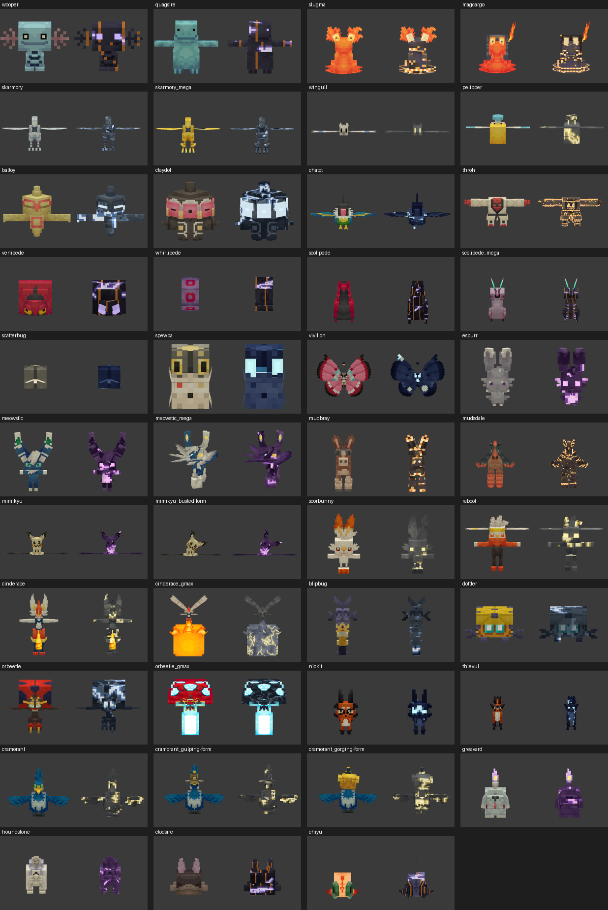

## Collection #19: Abyss

18 evolutionary lines (**49 Pokémon**) touched by the void that stares back (three lines per look; not the sea, that's
Deep Sea):

* **the void** (the Eevee family, Magikarp, Sandygast): inky starless black with a violet shimmer and drifting motes
* **rift** (Geodude, Nosepass, Tyrunt): obsidian split by a web of glowing magenta cracks that **throb**
* **eyes** (Natu, Caterpie, Gimmighoul): a dark hide covered in yellow slit-pupilled eyes that **blink**
* **shadowflame** (Sneasel, Nidoran♂, Chespin): black with violet flames that **flicker** up from the feet
* **sigil** (Tapu Koko, Tapu Fini, Dwebble): dark slate carved with glowing green rune circles and glyph bands
* **veins** (Clamperl, Snivy, Lillipup): crimson-black with branching red veins that **pulse** up the body
* other forms (Mega Gyarados, Mega Chesnaught, Gigantamax Eevee and Butterfree, and Extra Megas' Mega Flareon and Mega
  Espeon) wear the look too
* shiny: the void's light turned round the colour wheel

Caterpie → Metapod → Butterfree · Nidoran♂ → Nidorino → Nidoking · Geodude → Graveler → Golem · Magikarp → Gyarados · Eevee → Vaporeon / Jolteon / Flareon / Espeon / Umbreon / Leafeon / Glaceon / Sylveon · Natu → Xatu · Sneasel → Weavile / Sneasler · Nosepass → Probopass · Clamperl → Huntail / Gorebyss · Snivy → Servine → Serperior · Lillipup → Herdier → Stoutland · Dwebble → Crustle · Chespin → Quilladin → Chesnaught · Tyrunt → Tyrantrum · Sandygast → Palossand · Tapu Koko · Tapu Fini · Gimmighoul → Gholdengo

Picked with `generate.py pick --count 18 --seed abyss-void-gaze` from the 145 remaining eligible lines.

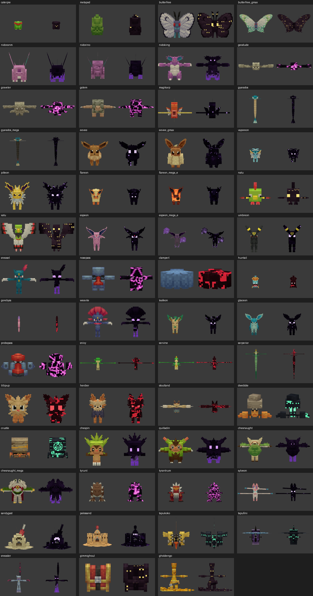

## Collection #20: Ancient Ruins

18 evolutionary lines (**33 Pokémon**) as relics of lost temples: the body cut into carved stone courses and blocks,
cracked and weathered, with rows of ancient glyphs that still glow (three lines per look; not the plain Stone Statues
of #8):

* **Mesoamerican** (Numel, Flamigo, Darumaka): warm sandstone with stepped-fret bands, jade inlays, turquoise glyphs
* **hieroglyph** (Sinistea, Poltchageist, Enamorus): pale limestone with lapis-and-gold bands and amber glyph rows
* **overgrown** (Foongus, Joltik, Wurmple): jungle-temple stone swallowed by moss with vines hanging down
* **sunken** (Dondozo, Palkia, Illumise): sea-worn blue-grey stone with barnacles, coral, seaweed and aqua glyphs
* **sandstone** (Rhyhorn, Shieldon, Volbeat): wind-eroded strata in ochre and cream with sand drifted round the feet
* **guardian** (Deoxys, Tinkatink, Morpeko): black basalt cut with glowing orange dot-glyph circuits
* the glyphs and eyes **glow in the dark** and slowly **pulse**
* other forms (Mega Camerupt, Galarian Darumaka and Darmanitan incl. Zen Mode, Deoxys' Attack, Defense and Speed
  Formes, Origin Palkia, Therian Enamorus) wear the look too
* shiny: paler stone, the glyph light turned round the colour wheel

Rhyhorn → Rhydon → Rhyperior · Wurmple → Silcoon → Beautifly / Cascoon → Dustox · Volbeat · Illumise ·
Numel → Camerupt · Deoxys · Shieldon → Bastiodon · Palkia · Darumaka → Darmanitan · Foongus → Amoonguss ·
Joltik → Galvantula · Sinistea → Polteageist · Morpeko · Enamorus · Tinkatink → Tinkatuff → Tinkaton · Flamigo ·
Dondozo · Poltchageist → Sinistcha

Picked with `generate.py pick --count 18 --seed ancient-ruins-glyph` from the 127 remaining eligible lines.

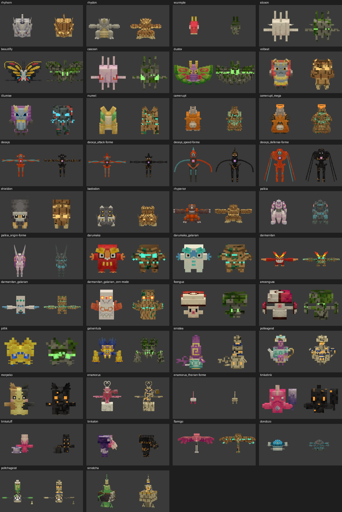

## Collection #21: Gilded

18 evolutionary lines (**36 Pokémon**) made precious with gold (three lines per look):

* **gold leaf** (Machop, Landorus, Meltan): burnished gold leaf laid in squares over dark red lacquer
* **kintsugi** (Wobbuffet, Shellos, Binacle): its own colours as glazed ceramic, the cracks mended with gold
* **filigree** (Sableye, Mawile, Poochyena): black velvet worked with an open gold trellis (and scroll spirals on
  bigger textures)
* **rose gold** (Hoppip, Ponyta, Glimmet): polished rose gold set with tiny diamonds that **sparkle**
* **jewelled** (Dratini, Starly, Tatsugiri): polished gold studded with rubies, emeralds, sapphires and amethysts
* **gilded marble** (Stantler, Farfetch'd, Skrelp): white marble veined with grey and threaded with gold
* polished metal shading; light **glints** off the gold, runs along the gold seams and veins, the gems glow softly in
  the dark; gem-bright eyes
* other forms (Mega Dragonite, Sableye, Mawile, Staraptor, Barbaracle, Dragalge and Glimmora, Gigantamax Machamp and
  Melmetal, Therian Landorus) wear the look too
* shiny: platinum and silver instead of gold, the gems turned round the colour wheel

Machop → Machoke → Machamp · Ponyta → Rapidash · Farfetch'd → Sirfetch'd · Dratini → Dragonair → Dragonite ·
Hoppip → Skiploom → Jumpluff · Wynaut → Wobbuffet · Stantler → Wyrdeer · Poochyena → Mightyena · Sableye · Mawile ·
Starly → Staravia → Staraptor · Shellos → Gastrodon · Landorus · Binacle → Barbaracle · Skrelp → Dragalge ·
Meltan → Melmetal · Glimmet → Glimmora · Tatsugiri

Picked with `generate.py pick --count 18 --seed gilded-gold-leaf` from the 109 remaining eligible lines.

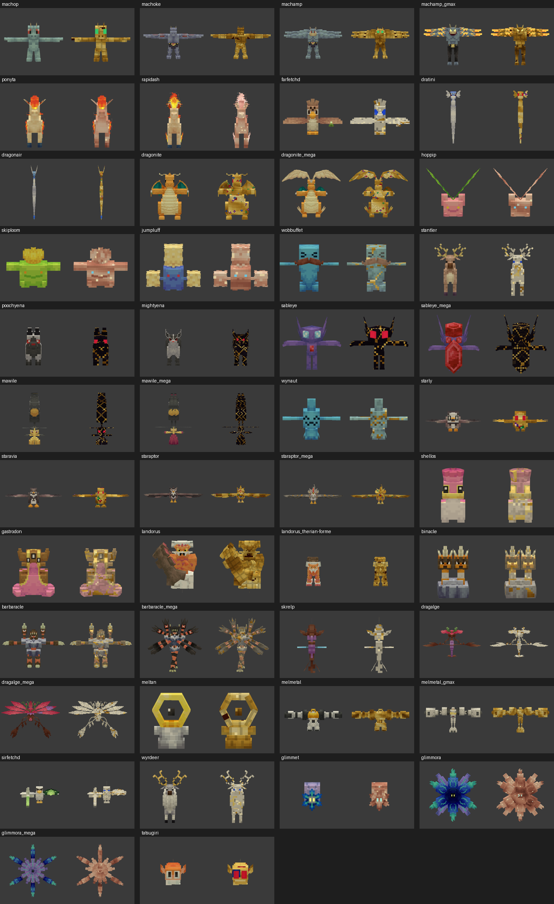

## Collection #22: Glacial

18 evolutionary lines (**32 Pokémon**) in the grip of the deep cold (three lines per look; frost and glacier ice, not
the clear carved Ice Sculptures of #7):

* **frostbite** (Rattata, Taillow, Ledyba): its own colours frosted pale, white rime creeping in from every edge
* **glacier** (Golett, Duraludon, Diancie): deep blue banded glacier ice with dark crevasses and a snow cap
* **permafrost** (Sandshrew, Wimpod, Wo-Chien): frozen dark earth threaded with ice lenses and hoarfrost
* **aurora ice** (Noibat, Staryu, Plusle): pale clear ice with the northern lights' greens and violets **rippling** across
* **frozen in** (Mareanie, Turtonator, Dracozolt): its own colours seen through blue ice, with bubbles and white cracks
* **blizzard** (Litwick, Milcery, Gossifleur): crusted with snow drifts, snowflakes and wind-blown streaks
* the ice **glints and sparkles** in the dark; icy glowing eyes
* other forms (Mega Starmie, Golurk, Chandelure, Diancie and Golisopod, Extra Megas' Mega Raticate, Gigantamax
  Alcremie and Duraludon) wear the look too
* shiny: the ice's light turned round the colour wheel

Rattata → Raticate · Sandshrew → Sandslash · Staryu → Starmie · Ledyba → Ledian · Taillow → Swellow · Plusle ·
Litwick → Lampent → Chandelure · Golett → Golurk · Noibat → Noivern · Diancie · Mareanie → Toxapex ·
Wimpod → Golisopod · Turtonator · Gossifleur → Eldegoss · Milcery → Alcremie · Dracozolt ·
Duraludon → Archaludon · Wo-Chien

Picked with `generate.py pick --count 18 --seed glacial-permafrost` from the 91 remaining eligible lines.

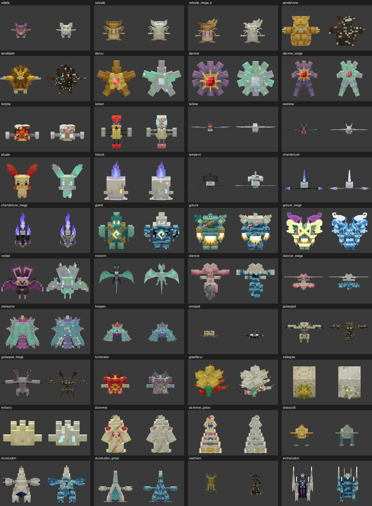

## Collection #23: Kitsune

18 evolutionary lines (**35 Pokémon**) as fox spirits of shrine and legend: kitsune mask markings on the face (a
forehead flame and swept cheek stripes), and ears, tails and crests burning with **foxfire** that flickers in the dark
(three lines per look):

* **Inari** (Riolu, Furfrou, Abra): the white shrine fox, snowy fur with vermilion markings and warm orange foxfire
* **kitsunebi** (Gastly, Rotom, Tentacool): dark indigo haunted by **drifting** blue-white foxfire wisps
* **nogitsune** (Scraggy, Okidogi, Varoom): the wild fox, black fur with gold markings and violet flames
* **tenko** (Shaymin, Castform, Flabébé): the celestial fox, pale gold fading to sky blue, dusted with stars
* **shrine** (Sudowoodo, Burmy, Lileep): vermilion lacquer over black, a straw shimenawa rope hung with paper shide
* **autumn** (Petilil, Shroomish, Yanma): russet fur scattered with red and gold maple leaves, ember-red fire
* other forms (Mega Alakazam, Gengar, Lucario incl. Mega Z, Scrafty and Eternal Floette, Gigantamax Gengar, every
  Rotom appliance, Castform's weather forms, Sky Shaymin) wear the look too; Poke Costumes' outfits for Lucario and
  Revavroom keep their own art (that pack allows no derivatives)
* shiny: the foxfire turned round the colour wheel

Abra → Kadabra → Alakazam · Tentacool → Tentacruel · Gastly → Haunter → Gengar · Bonsly → Sudowoodo ·
Yanma → Yanmega · Shroomish → Breloom · Lileep → Cradily · Castform · Burmy → Wormadam / Mothim · Riolu → Lucario ·
Rotom · Shaymin · Petilil → Lilligant · Scraggy → Scrafty · Flabébé → Floette → Florges · Furfrou ·
Varoom → Revavroom · Okidogi

Picked with `generate.py pick --count 18 --seed kitsune-foxfire` from the 73 remaining eligible lines.

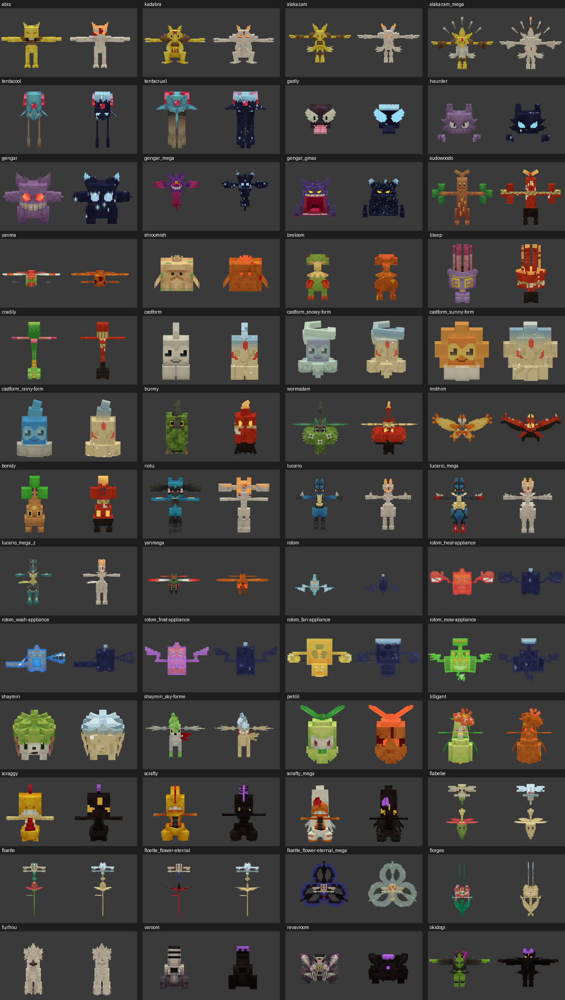

## Collection #24: Super Mario

18 evolutionary lines (**33 Pokémon**) dressed as power-ups and plumbing heroes (original patterns inspired by the
Super Mario games; three lines per look):

* **super mushroom** (Morelull, Chansey, Spinda): a red cap with big white spots over a cream stem
* **fire flower** (Heatmor, Oricorio, Bellsprout): white over red, a fire-flower emblem and **glowing fireballs**
* **super star** (Pachirisu, Ralts, Psyduck): star gold with a star on the chest, **flashing every colour**
* **? block** (Pumpkaboo, Bramblin, Lapras): golden ? blocks with **blinking** ? marks over a brick base
* **plumber** (Kubfu, Meditite, Indeedee): a red shirt, blue overalls with gold buttons and brown boots
* **koopa shell** (Dewpider, Woobat, Darkrai): green shell plates with cream seams over yellow skin
* the eyes keep their own colours; other forms (Mega Victreebel, Gardevoir, Gallade and Medicham, Gigantamax Lapras
  and Urshifu, every Oricorio style, Rapid Strike Urshifu) wear the look too
* shiny: the other power-ups: the green 1-up mushroom, the ice flower, blue underground blocks, green shirt and navy
  overalls, a red shell

Psyduck → Golduck · Bellsprout → Weepinbell → Victreebel · Happiny → Chansey → Blissey · Lapras ·
Ralts → Kirlia → Gardevoir / Gallade · Meditite → Medicham · Spinda · Pachirisu · Darkrai · Woobat → Swoobat ·
Heatmor · Pumpkaboo → Gourgeist · Oricorio · Dewpider → Araquanid · Morelull → Shiinotic · Indeedee ·
Kubfu → Urshifu · Bramblin → Brambleghast

Picked with `generate.py pick --count 18 --seed super-star-power-up` (all never-used lines).

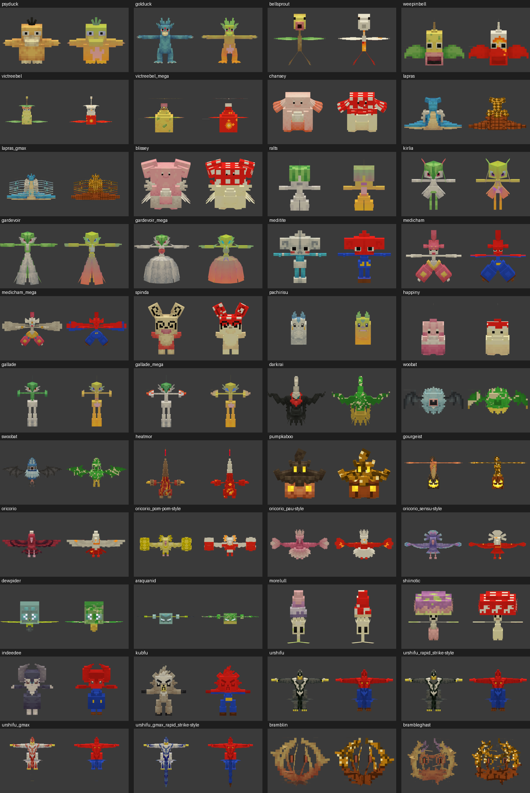

## Collection #25: Nimbus

18 evolutionary lines (**28 Pokémon**) made of sky and cloud (three lines per look):

* **cumulus** (Lugia, Wailmer, Surskit): fluffy white clouds billowing over a blue sky
* **storm** (Tornadus, Druddigon, Scyther): a dark thunderhead with slanting rain; lightning **strikes** in the dark
* **sunset** (Fezandipiti, Exeggcute, Remoraid): clouds lit gold, pink and violet, their edges glowing
* **rain** (Wishiwashi, Stunfisk, Arctovish): grey clouds over the top, raindrops **falling** down the body
* **silver lining** (Type: Null, Glastrier, Inkay): dark clouds whose edges shine silver
* **cloud nine** (Meloetta, Tapu Lele, Oshawott): pastel dream clouds with **twinkling** stars
* soft glowing eyes; other forms (Mega Scizor and Malamar, Therian Tornadus, Pirouette Meloetta, School Wishiwashi)
  wear the look too
* shiny: the sky turned round the colour wheel

Exeggcute → Exeggutor · Scyther → Scizor / Kleavor · Remoraid → Octillery · Lugia · Surskit → Masquerain ·
Wailmer → Wailord · Oshawott → Dewott → Samurott · Stunfisk · Druddigon · Tornadus · Meloetta · Inkay → Malamar ·
Wishiwashi · Type: Null → Silvally · Tapu Lele · Arctovish · Glastrier · Fezandipiti

Picked with `generate.py pick --count 18 --seed nimbus-cloud-nine` (all never-used lines).

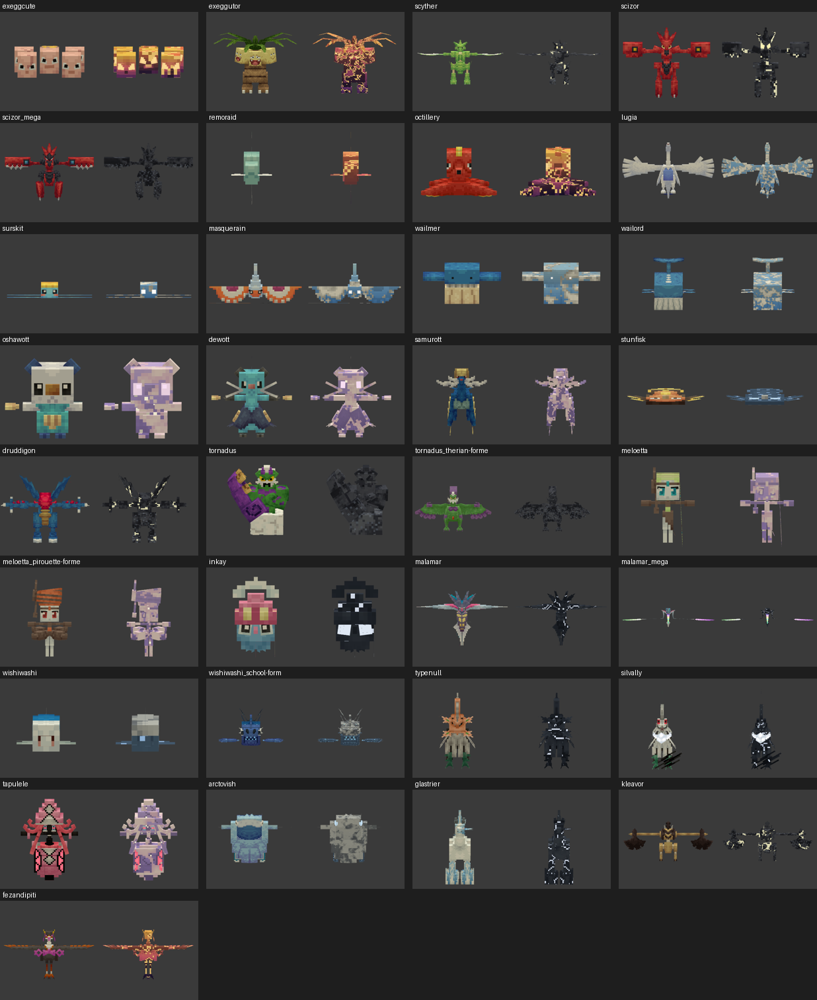

## Collection #26: Pajama

18 evolutionary lines (**30 Pokémon**) ready for bed in soft printed sleepwear, with flannel shading, a button
placket down the chest and ankle cuffs (three lines per look):

* **pinstripes** (Sawk, Arrokuda, Regieleki): classic sky-blue and white
* **polka dots** (Ditto, Alomomola, Roselia): pink with white dots
* **flannel plaid** (Terrakion, Tapu Bulu, Skwovet): red tartan
* **moons and stars** (Houndour, Deino, Spectrier): navy with yellow moons and **glow-in-the-dark** stars
* **footie onesie** (Minccino, Drampa, Orthworm): mint fleece with a cream belly and grippy soles
* **gingham** (Treecko, Froakie, Chien-Pao): sunny yellow check
* the eyes keep their own colours; other forms (Mega Houndoom, Sceptile, Greninja and Drampa, Ash-Greninja) wear the
  pajamas too
* shiny: the fabric's colours turned round the colour wheel

Ditto · Houndour → Houndoom · Treecko → Grovyle → Sceptile · Budew → Roselia → Roserade · Sawk ·
Minccino → Cinccino · Alomomola · Deino → Zweilous → Hydreigon · Terrakion · Froakie → Frogadier → Greninja ·
Drampa · Tapu Bulu · Skwovet → Greedent · Arrokuda → Barraskewda · Regieleki · Spectrier · Orthworm · Chien-Pao

Picked with `generate.py pick --count 18 --seed pajama-sleepover` (all never-used lines).

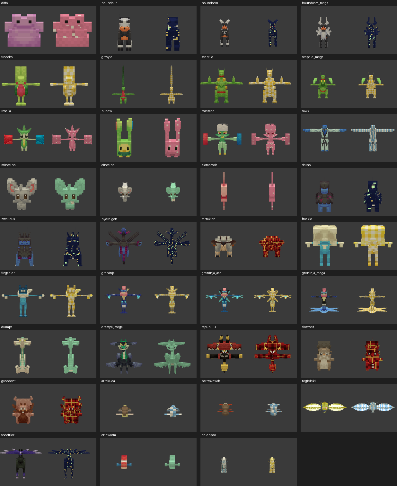

## Collection #27: Pinkan Island

18 evolutionary lines (**36 Pokémon**) turned pink by Pinkan Berries, like the Pokémon of the anime's Pinkan Island
(three lines per pink):

* **Pinkan pink** (Growlithe, Doduo, Zigzagoon): the classic, light and dark kept
* **Pinkan Berries** (Skwovet, Carbink, Cryogonal): pink with clusters of darker berries
* **bubblegum** (Alomomola, Espurr, Spheal): soft pastel with white highlights
* **hot pink** (Scraggy, Honedge, Gastly): vivid magenta-pink
* **flamingo coral** (Skrelp, Tentacool, Drampa): warm coral pink
* **Pinkan jungle** (Petilil, Tapu Koko, Venipede): pink with a jungle-leaf print
* tiny pink sparkles **twinkle**; the eyes keep their own colours; other forms (Mega Gengar, Scolipede, Scrafty,
  Meowstic, Dragalge and Drampa, Gigantamax Gengar, Blade Forme Aegislash) are pink too
* shiny: lavender-pink instead of rose

Growlithe → Arcanine · Tentacool → Tentacruel · Doduo → Dodrio · Gastly → Haunter → Gengar ·
Zigzagoon → Linoone → Obstagoon · Spheal → Sealeo → Walrein · Venipede → Whirlipede → Scolipede ·
Petilil → Lilligant · Scraggy → Scrafty · Alomomola · Cryogonal · Espurr → Meowstic · Honedge → Doublade → Aegislash ·
Skrelp → Dragalge · Carbink · Drampa · Tapu Koko · Skwovet → Greedent

Picked with `generate.py pick --count 18 --seed pinkan-island-berry` (Cryogonal the last never-used line, the rest
lines already in one other collection).

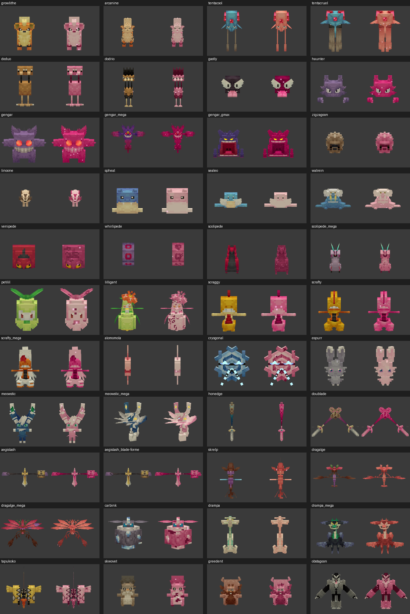

## Collection #28: Prismatic

18 evolutionary lines (**37 Pokémon**) that split light into every colour (three lines per look):

* **holo foil** (Rattata, Bidoof, Pikipek): silver foil with rainbow sheen bands
* **spectrum** (Ekans, Poliwag, Basculin): the full spectrum from red feet to a violet top
* **crystal facets** (Sableye, Sandshrew, Crabrawler): facets each a different hue, bright white edges
* **opal** (Shuppet, Mimikyu, Lillipup): milky opal with flashes of play-of-colour
* **oil slick** (Nymble, Carnivine, Arctozolt): dark graphite with a swirling thin-film sheen
* **prism light** (Sudowoodo, Chespin, Mudbray): white glass crossed by beams of refracted light
* the colours **shift round the wheel** in the dark; rainbow eyes; other forms (Mega Sableye, Banette, Chesnaught and
  Crabominable, Extra Megas' Mega Raticate, Busted Mimikyu) wear the look too
* shiny: black opal, a darker body that makes the colours blaze

Rattata → Raticate · Ekans → Arbok · Sandshrew → Sandslash · Poliwag → Poliwhirl → Poliwrath / Politoed ·
Bonsly → Sudowoodo · Sableye · Shuppet → Banette · Bidoof → Bibarel · Carnivine · Lillipup → Herdier → Stoutland ·
Basculin → Basculegion · Chespin → Quilladin → Chesnaught · Pikipek → Trumbeak → Toucannon ·
Crabrawler → Crabominable · Mudbray → Mudsdale · Mimikyu · Arctozolt · Nymble → Lokix

Picked with `generate.py pick --count 18 --seed prismatic-spectrum` (lines already in one other collection).

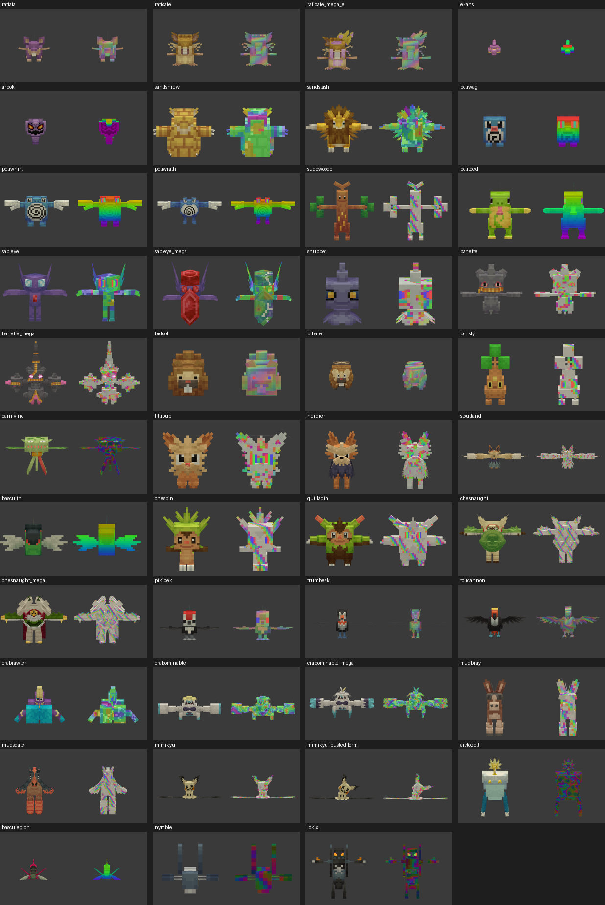

## Collection #29: Sakura

18 evolutionary lines (**44 Pokémon**) in cherry-blossom season (three lines per look):

* **blossom** (Flabébé, Swirlix, Marill): blush pink scattered with white-pink five-petalled blossoms
* **hanami** (Oddish, Shuckle, Stonjourner): pale cream with cherry branches in bloom
* **yozakura** (Gimmighoul, Kecleon, Tynamo): night sakura on deep navy, **glowing** blossoms and paper lanterns
* **kimono** (Rookidee, Cramorant, Bouffalant): pink silk printed with sakura, a red obi with a gold cord
* **petal storm** (Caterpie, Wurmple, Trapinch): blush pink with petals **drifting** across
* **spring** (Nacli, Bergmite, Magnemite): fresh green dotted with blossom
* the eyes keep their own colours; other forms (Mega Eelektross, Eternal Floette and its mega, Gigantamax Butterfree
  and Corviknight, Cramorant's Gulping and Gorging forms) bloom too
* shiny: white-and-gold plum blossom

Caterpie → Metapod → Butterfree · Oddish → Gloom → Vileplume / Bellossom · Magnemite → Magneton → Magnezone ·
Azurill → Marill → Azumarill · Shuckle · Wurmple → Silcoon → Beautifly / Cascoon → Dustox · Trapinch → Vibrava → Flygon ·
Kecleon · Tynamo → Eelektrik → Eelektross · Bouffalant · Flabébé → Floette → Florges · Swirlix → Slurpuff ·
Bergmite → Avalugg · Rookidee → Corvisquire → Corviknight · Cramorant · Stonjourner · Nacli → Naclstack → Garganacl ·
Gimmighoul → Gholdengo

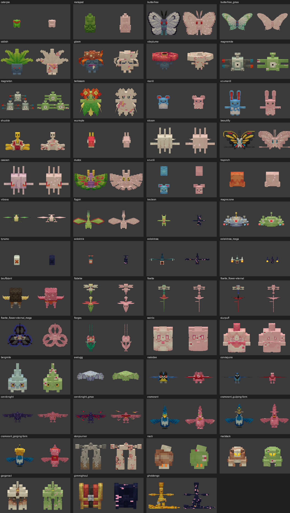

## Collection #30: Shadow

18 evolutionary lines (**34 Pokémon**) whose hearts have been closed, wreathed in a dark aura (after the shadow Pokémon of
Colosseum and XD; three lines per look):

* **shadow aura** (Misdreavus, Spiritomb, Unown): violet-black with a purple aura **flickering** off every edge
* **hyper mode** (Houndour, Totodile, Druddigon): crimson-black with a raging red aura and burning red eyes
* **eclipse** (Zorua, Diancie, Rowlet): near black, rimmed with thin violet light
* **smoke** (Lickitung, Dunsparce, Eiscue): smoky grey-black with dark wisps rising
* **ember** (Cyclizar, Hitmonlee, Yamper): charred dark with smouldering crimson cracks
* **cipher** (Spoink, Karrablast, Bramblin): dark violet broken up by glitching scanlines
* other forms (Mega Houndoom, Feraligatr and Diancie) are shadows too
* shiny: the aura's colour turned round the colour wheel

Tyrogue → Hitmonlee / Hitmonchan / Hitmontop · Lickitung → Lickilicky · Totodile → Croconaw → Feraligatr ·
Misdreavus → Mismagius · Unown · Dunsparce → Dudunsparce · Houndour → Houndoom · Spoink → Grumpig · Spiritomb ·
Zorua → Zoroark · Karrablast → Escavalier · Druddigon · Diancie · Rowlet → Dartrix → Decidueye · Yamper → Boltund ·
Eiscue · Bramblin → Brambleghast · Cyclizar

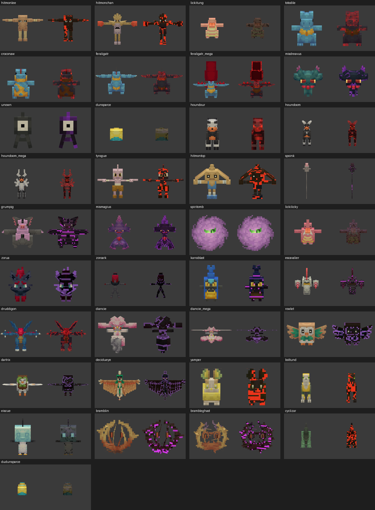

## Collection #31: Slayer

18 evolutionary lines (**37 Pokémon**) as demon slayers: a patterned haori over a dark navy uniform with a white belt,
and a breathing style that glows in the dark (inspired by the Demon Slayer anime; the patterns are traditional
Japanese motifs; three lines per look):

* **checkered** (Kubfu, Spinda, Fidough): green-and-black ichimatsu checks, fire **flickering** at the hem
* **water** (Buizel, Bruxish, Quaxly): blue-and-white seigaiha wave scales; the waves **roll**
* **flame** (Seedot, Maractus, Spearow): a white haori with flames licking up from the hem
* **thunder** (Dreepy, Staryu, Poochyena): yellow with white uroko triangle scales; lightning **crackles**
* **insect** (Lileep, Bellsprout, Natu): a butterfly-wing haori with black veins and glowing spots
* **mist** (Trubbish, Terapagos, Smoliv): mist-white fading to cyan with mist **drifting** over it
* the eyes keep their own colours; other forms (Mega Starmie and Victreebel, Gigantamax Garbodor and Urshifu, Rapid
  Strike Urshifu, Terastal and Stellar Terapagos) wear the haori too
* shiny: the haori's colours turned round the colour wheel

Spearow → Fearow · Bellsprout → Weepinbell → Victreebel · Staryu → Starmie · Natu → Xatu · Poochyena → Mightyena ·
Seedot → Nuzleaf → Shiftry · Spinda · Lileep → Cradily · Buizel → Floatzel · Maractus · Trubbish → Garbodor · Bruxish ·
Dreepy → Drakloak → Dragapult · Kubfu → Urshifu · Quaxly → Quaxwell → Quaquaval · Fidough → Dachsbun ·
Smoliv → Dolliv → Arboliva · Terapagos

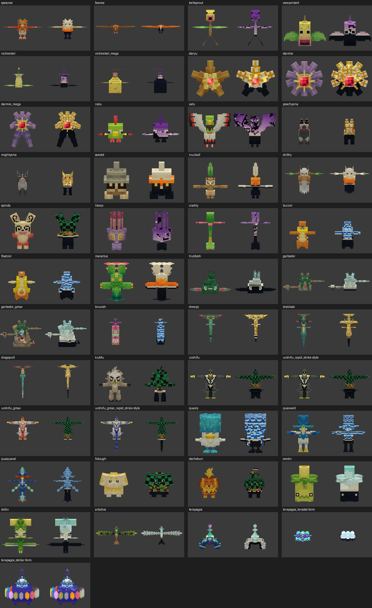

## Collection #32: Sunburst

18 evolutionary lines (**26 Pokémon**) blazing with sunlight (three lines per look):

* **sun rays** (Victini, Nosepass, Skarmory): gold and orange rays bursting from the chest
* **sunrise** (Deerling, Mareep, Tatsugiri): rose, orange, gold and pale morning yellow from toe to head
* **solar flare** (Turtonator, Okidogi, Walking Wake): molten gold with a corona of flares **licking** off it
* **sunflower** (Snover, Foongus, Oricorio): petals radiating round a brown seed head on the chest
* **art deco** (Rotom, Seviper, Dracovish): black lacquer with gold sunburst fans and arcs
* **tropical** (Ditto, Nidoran♂, Thundurus): hot tropical orange and yellow with little suns
* the light **shimmers** in the dark; warm glowing eyes; other forms (Mega Skarmory, Ampharos and Abomasnow, every
  Rotom appliance and Oricorio style, Therian Thundurus) shine too
* shiny: a white-gold midnight sun

Nidoran♂ → Nidorino → Nidoking · Ditto · Mareep → Flaaffy → Ampharos · Skarmory · Nosepass → Probopass · Seviper ·
Snover → Abomasnow · Rotom · Victini · Deerling → Sawsbuck · Foongus → Amoonguss · Thundurus · Oricorio · Turtonator ·
Dracovish · Tatsugiri · Walking Wake · Okidogi

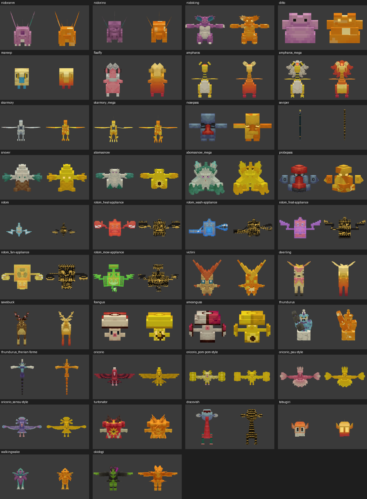

## Collection #33: Toxic Chain

18 evolutionary lines (**29 Pokémon**) bound by poisonous chains and mochi (after Pecharunt's Toxic Chain; three lines
per look):

* **chains** (Darkrai, Duraludon, Dondozo): dark violet bound with glowing magenta chain links that **throb**
* **toxic mochi** (Audino, Chimecho, Castform): glossy lilac mochi with toxic speckles and glowing spots
* **ooze** (Tadbulb, Orthworm, Flamigo): toxic ooze **dripping** down from the top
* **sludge** (Teddiursa, Turtwig, Stunfisk): green-and-purple sludge whose bubbles **pop**
* **venom** (Dratini, Meditite, Emolga): glowing venom veins that **pulse**
* **poison haze** (Meloetta, Volbeat, Poltchageist): lavender wreathed in **swirling** poison gas
* glowing magenta eyes; other forms (Mega Dragonite, Medicham, Audino and Chimecho, Extra Megas' Mega Torterra,
  Gigantamax Duraludon, Bloodmoon Ursaluna, Castform's weather forms, Pirouette Meloetta) are poisoned too
* shiny: the poison turned round the colour wheel

Dratini → Dragonair → Dragonite · Teddiursa → Ursaring → Ursaluna · Meditite → Medicham · Volbeat · Castform ·
Chingling → Chimecho · Turtwig → Grotle → Torterra · Darkrai · Audino · Emolga · Stunfisk · Meloetta ·
Duraludon → Archaludon · Tadbulb → Bellibolt · Orthworm · Flamigo · Dondozo · Poltchageist → Sinistcha

All five picked with `generate.py pick --count 18` (seeds sakura-hanami, shadow-aura-snag, slayer-breathing,
sunburst-solstice, toxic-chain-mochi) from lines already in one other collection.

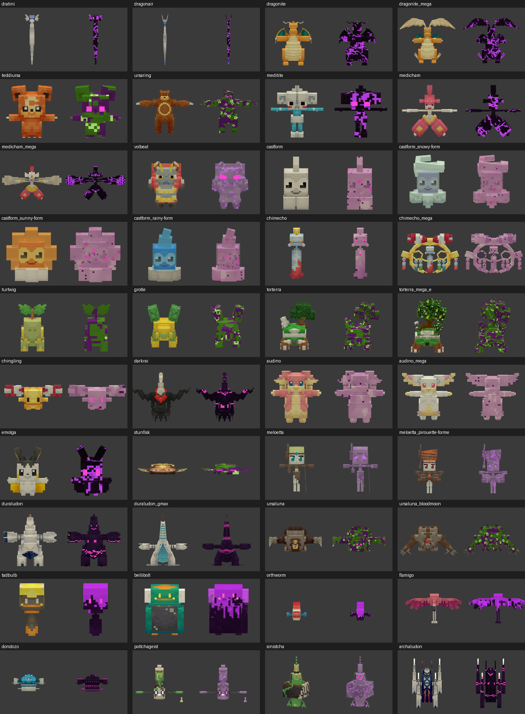

## Collection #34: Undertale

18 evolutionary lines (**42 Pokémon**) in the monochrome style of an underground RPG, each carrying a human SOUL
(inspired by Undertale; original art, no game sprites): dithered black, grey and white bodies with a white battle-box
outline, white eyes and a **SOUL heart on the chest that glows and beats** in the dark (three lines per SOUL):

* **determination** (Litten, Cyndaquil, Chansey): red, with save-point sparkles
* **bravery** (Corsola, Applin, Patrat): orange pellets
* **justice** (Sentret, Yanma, Smeargle): little yellow stars
* **kindness** (Lotad, Lechonk, Shellos): green plus-sign heals
* **patience** (Pyukumuku, Shellder, Glastrier): cyan rope bands
* **integrity** (Woobat, Duskull, Blipbug): blue diamonds
* other forms (Gigantamax Orbeetle, Flapple and Appletun) carry their SOULs too
* shiny: the SOUL colours turned round the colour wheel

Shellder → Cloyster · Happiny → Chansey → Blissey · Cyndaquil → Quilava → Typhlosion · Sentret → Furret ·
Yanma → Yanmega · Corsola → Cursola · Smeargle · Lotad → Lombre → Ludicolo · Duskull → Dusclops → Dusknoir ·
Shellos → Gastrodon · Patrat → Watchog · Woobat → Swoobat · Litten → Torracat → Incineroar · Pyukumuku ·
Blipbug → Dottler → Orbeetle · Applin → Flapple / Appletun / Dipplin → Hydrapple · Glastrier · Lechonk → Oinkologne

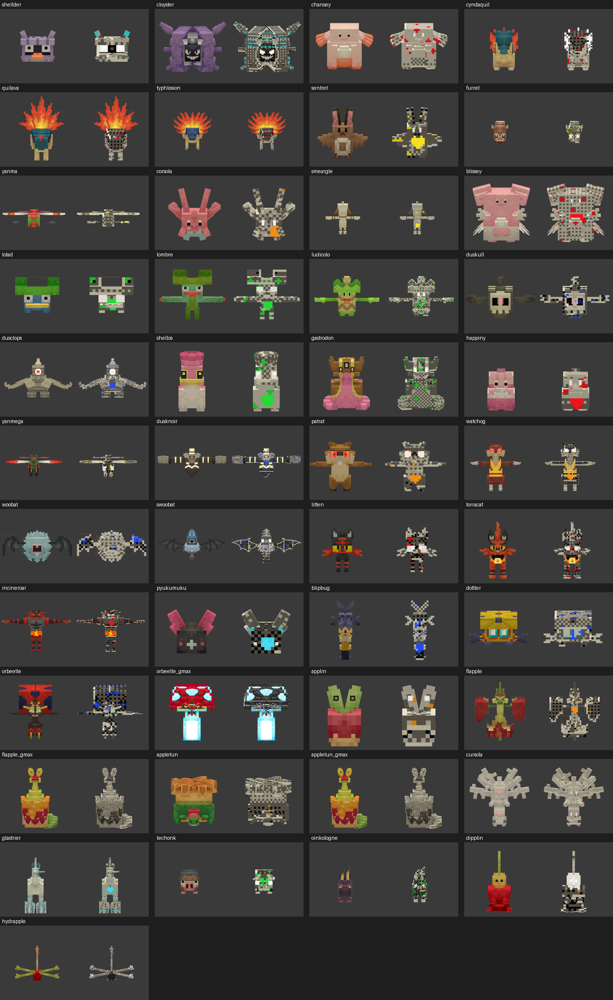

## Collection #35: Pokémon Unite

18 evolutionary lines (**35 Pokémon**) in team-colour holowear outfits (inspired by Pokémon Unite's holowear; original
designs); the regular look is the **purple team**, the shiny the **orange team** (three lines per outfit):

* **jersey** (Pikachu, Timburr, Blitzle): a team jersey with white bands and dark shorts
* **holowear** (Genesect, Beldum, Bronzor): dark navy with a glowing team-colour hex grid that **sparkles**
* **concert** (Cutiefly, Hatenna, Glimmet): a stage outfit glittering with sequins
* **formal** (Mawile, Snubbull, Komala): a black tuxedo with a white shirt front and a team bow tie
* **festival** (Cherubi, Delibird, Cubone): a team-colour yukata printed with white waves, an obi
* **beach** (Tyrunt, Cufant, Tapu Bulu): a Hawaiian shirt with white and yellow flowers
* the eyes keep their own colours; other forms (every costume Pikachu, Gigantamax Pikachu, Hatterene and Copperajah,
  Mega Raichu X and Y, Mega Mawile, Metagross and Glimmora, Genesect's drives) suit up too

Pichu → Pikachu → Raichu · Cubone → Marowak · Snubbull → Granbull · Delibird · Mawile · Beldum → Metang → Metagross ·
Cherubi → Cherrim · Bronzor → Bronzong · Blitzle → Zebstrika · Timburr → Gurdurr → Conkeldurr · Genesect ·
Tyrunt → Tyrantrum · Cutiefly → Ribombee · Komala · Tapu Bulu · Hatenna → Hattrem → Hatterene · Cufant → Copperajah ·
Glimmet → Glimmora

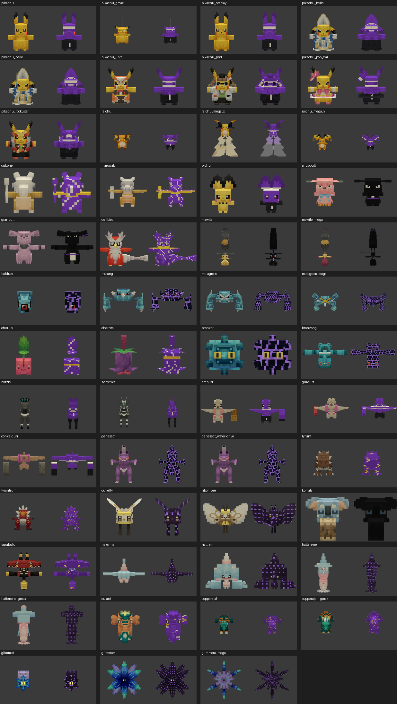

## Collection #36: Zelda

18 evolutionary lines (**37 Pokémon**) of the kingdom of Hyrule (inspired by The Legend of Zelda; original patterns;
three lines per look):

* **hero's tunic** (Falinks, Fomantis, Morpeko): a green tunic and brown belt with a golden triangle emblem that glows
* **ancient tech** (Kabuto, Omanyte, Solrock): slate stone carved with glowing cyan circuits that **pulse**
* **Zora** (Squirtle, Seel, Qwilfish): sleek blue scales with a silver-white belly
* **Goron** (Phanpy, Hippopotas, Wiglett): rocky brown hide with dark cracks and a warm belly
* **Gerudo** (Gothita, Larvesta, Drifloon): desert crimson with gold bands and gleaming turquoise gems
* **Korok** (Hoppip, Tarountula, Snorunt): wood bark with a crown of leaves
* the eyes keep their own colours; other forms (Mega Blastoise, Glalie, Froslass and Falinks, Gigantamax Blastoise)
  join Hyrule too
* shiny: twilight, the colours turned round the colour wheel

Squirtle → Wartortle → Blastoise · Seel → Dewgong · Omanyte → Omastar · Kabuto → Kabutops ·
Hoppip → Skiploom → Jumpluff · Qwilfish → Overqwil · Phanpy → Donphan · Solrock · Snorunt → Glalie / Froslass ·
Drifloon → Drifblim · Hippopotas → Hippowdon · Gothita → Gothorita → Gothitelle · Larvesta → Volcarona ·
Fomantis → Lurantis · Falinks · Morpeko · Tarountula → Spidops · Wiglett → Wugtrio

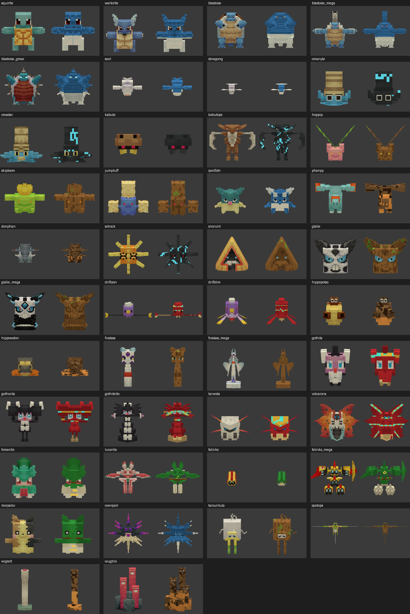

## Collection #37: Valentine's Day

18 evolutionary lines (**38 Pokémon**) full of love (three lines per look):

* **hearts** (Luvdisc, Clefairy, Buneary): sweet pink covered in red and white hearts
* **love letter** (Mr. Mime, Yamask, Hoopa): cream writing paper with a red wax heart seal
* **chocolate** (Bunnelby, Roggenrola, Makuhita): milk chocolate with drizzle, sprinkles and a frosted heart
* **cupid** (Snom, Flittle, Gligar): angel white with golden arrows and little pink hearts
* **roses** (Goldeen, Heatmor, Regieleki): swirling deep red rose petals with green leaves
* **candy hearts** (Goomy, Mankey, Anorith): white scattered with pastel candy hearts
* the hearts glow softly and **beat** in the dark; the eyes keep their own colours; other forms (Mega Clefable and
  Lopunny, Extra Megas' Mega Annihilape, Hoopa Unbound) fall in love too
* shiny: the love turned round the colour wheel

Cleffa → Clefairy → Clefable · Mankey → Primeape → Annihilape · Goldeen → Seaking · Mime Jr. → Mr. Mime → Mr. Rime ·
Gligar → Gliscor · Makuhita → Hariyama · Anorith → Armaldo · Buneary → Lopunny · Roggenrola → Boldore → Gigalith ·
Yamask → Cofagrigus / Runerigus · Heatmor · Bunnelby → Diggersby · Goomy → Sliggoo → Goodra · Hoopa · Luvdisc ·
Snom → Frosmoth · Regieleki · Flittle → Espathra

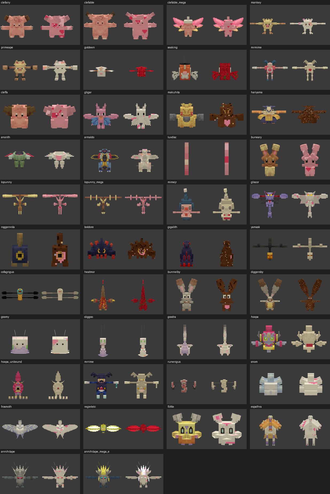

## Collection #38: St. Patrick's Day

18 evolutionary lines (**36 Pokémon**) with the luck of the Irish (three lines per look):

* **shamrock** (Shaymin, Jigglypuff, Popplio): emerald green scattered with shamrocks, lucky sparkles **twinkling**
* **leprechaun** (Impidimp, Croagunk, Marshadow): a green coat, black belt and gold buckle, a gold hat band
* **pot of gold** (Heatran, Pawniard, Darumaka): heaped gold coins over a black iron pot; the gold **glints**
* **rainbow** (Lugia, Azelf, Shinx): rainbow bands from the feet up over white clouds
* **Celtic** (Stantler, Terrakion, Tirtouga): deep green worked with gold knotwork
* **tartan** (Sawk, Tepig, Jangmo-o): an Irish green tartan with white and orange stripes
* the eyes keep their own colours; other forms (Galarian Darumaka and Darmanitan incl. Zen Mode, Mega Emboar, Extra
  Megas' Mega Luxray, Gigantamax Grimmsnarl, Sky Shaymin) are lucky too
* shiny: the green turned to gold

Igglybuff → Jigglypuff → Wigglytuff · Stantler → Wyrdeer · Lugia · Marshadow · Shinx → Luxio → Luxray ·
Croagunk → Toxicroak · Azelf · Heatran · Shaymin · Tepig → Pignite → Emboar · Sawk · Darumaka → Darmanitan ·
Tirtouga → Carracosta · Pawniard → Bisharp → Kingambit · Terrakion · Popplio → Brionne → Primarina ·
Jangmo-o → Hakamo-o → Kommo-o · Impidimp → Morgrem → Grimmsnarl

All five picked with `generate.py pick --count 18` (seeds undertale-determination, unite-holowear, zelda-triforce,
valentine-hearts, st-patrick-shamrock; Luvdisc swapped from St. Patrick's Day into Valentine's Day for Marshadow) from
lines already in other collections.

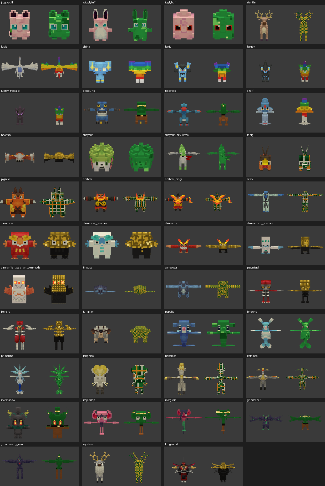

## Collection #39: April Fools' Day

18 evolutionary lines (**34 Pokémon**) playing pranks (three lines per prank):

* **jester** (Tapu Lele, Plusle, Capsakid): a red-and-yellow harlequin motley
* **clown** (Vanillite, Tandemaus, Carvanha): clown white with big polka dots and a red nose
* **googly eyes** (Geodude, Rhyhorn, Cryogonal): covered in googly eyes whose pupils **roll around**
* **wrong colours** (Paras, Aerodactyl, Cobalion): every colour swapped round the colour wheel
* **didn't load** (Archen, Varoom, Yungoos): pixelated into chunky blocks of few colours
* **confetti** (Stunky, Finneon, Sizzlipede): showered with confetti and streamers that **twinkle**
* other forms (Mega Aerodactyl, Sharpedo and Scovillain, Gigantamax Centiskorch) join the prank too
* shiny: the prank colours turned round the colour wheel

Paras → Parasect · Geodude → Graveler → Golem · Rhyhorn → Rhydon → Rhyperior · Aerodactyl · Plusle ·
Carvanha → Sharpedo · Stunky → Skuntank · Finneon → Lumineon · Archen → Archeops · Vanillite → Vanillish → Vanilluxe ·
Cryogonal · Cobalion · Yungoos → Gumshoos · Tapu Lele · Sizzlipede → Centiskorch · Tandemaus → Maushold ·
Capsakid → Scovillain · Varoom → Revavroom

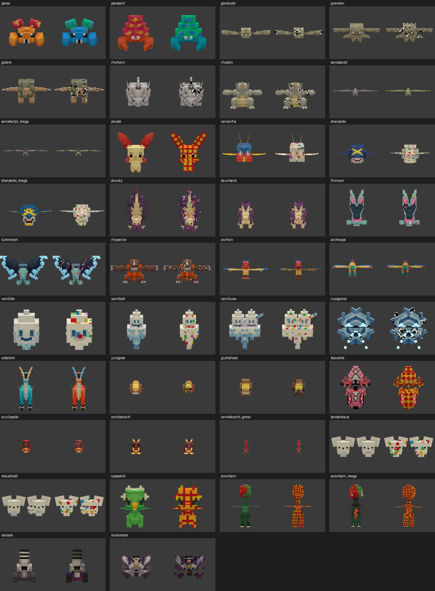

## Collection #40: Star Wars

18 evolutionary lines (**34 Pokémon**) from a galaxy far, far away (inspired by Star Wars; original patterns; three
lines per look):

* **Jedi** (Chimchar, Mudkip, Pansage): a cream tunic and belt under a brown robe, a blue blade that **hums**
* **Sith** (Munkidori, Inkay, Spinarak): a black robe with a red blade and red glowing eyes
* **trooper** (Miltank, Wobbuffet, Spritzee): white armour plates with black seams
* **beskar** (Palkia, Tornadus, Greavard): polished silver armour plates, a dark visor and a leather belt
* **astromech** (Toxel, Grimer, Ledyba): a white droid shell with blue panels and **blinking** lights
* **rebel pilot** (Bulbasaur, Noibat, Comfey): an orange flight suit with a white harness and a striped helmet top
* other forms (Mega Venusaur, Swampert and Malamar, Extra Megas' Mega Infernape, Gigantamax Venusaur and Toxtricity,
  Origin Palkia, Therian Tornadus) join up too
* shiny: the other side: a green blade, a purple blade, black shadow armour, gold beskar, red panels, a green suit

Bulbasaur → Ivysaur → Venusaur · Grimer → Muk · Ledyba → Ledian · Spinarak → Ariados · Wynaut → Wobbuffet · Miltank ·
Mudkip → Marshtomp → Swampert · Chimchar → Monferno → Infernape · Palkia · Pansage → Simisage · Tornadus ·
Spritzee → Aromatisse · Inkay → Malamar · Noibat → Noivern · Comfey · Toxel → Toxtricity · Greavard → Houndstone ·
Munkidori

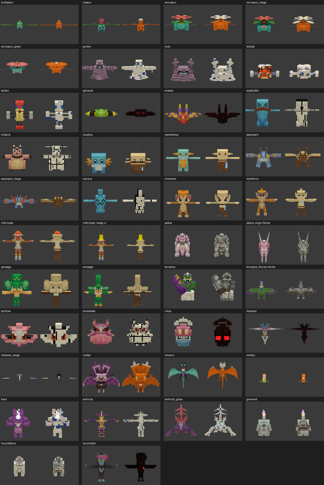

## Collection #41: LGBTQIA+ Pride

18 evolutionary lines (**38 Pokémon**) wearing pride flags, each flag's stripes running across the **whole body** from
head to toe (by the height of every texel on the model, like collection #10, Trans Pride), the original's light and
shade kept inside each stripe and the eyes their own colours (three lines per flag):

* **rainbow** (Milcery, Ralts, Eternatus): red, orange, yellow, green, blue, violet
* **bisexual** (Fletchling, Rufflet, Pidove): magenta, lavender, royal blue
* **pansexual** (Indeedee, Ducklett, Binacle): pink, yellow, cyan
* **lesbian** (Zarude, Veluza, Sandile): dark orange, orange, white, pink, dark rose
* **asexual** (Koffing, Rolycoly, Arctovish): black, grey, white, purple
* **nonbinary** (Swinub, Cubchoo, Farfetch'd): yellow, white, purple, black
* other forms (Mega Gardevoir, Gallade and Barbaracle, Gigantamax Alcremie and Coalossal, Eternamax Eternatus) fly
  the flags too
* shiny: pastel glitter over the stripes, plus sparkles that **twinkle** in the dark

Farfetch'd → Sirfetch'd · Koffing → Weezing · Swinub → Piloswine → Mamoswine · Ralts → Kirlia → Gardevoir / Gallade ·
Pidove → Tranquill → Unfezant · Sandile → Krokorok → Krookodile · Ducklett → Swanna · Cubchoo → Beartic ·
Rufflet → Braviary · Fletchling → Fletchinder → Talonflame · Binacle → Barbaracle · Rolycoly → Carkol → Coalossal ·
Milcery → Alcremie · Indeedee · Arctovish · Eternatus · Zarude · Veluza

All three picked with `generate.py pick --count 18` (seeds april-fools-prank, star-wars-galaxy, lgbtqia-pride-flags)
from lines already in other collections.

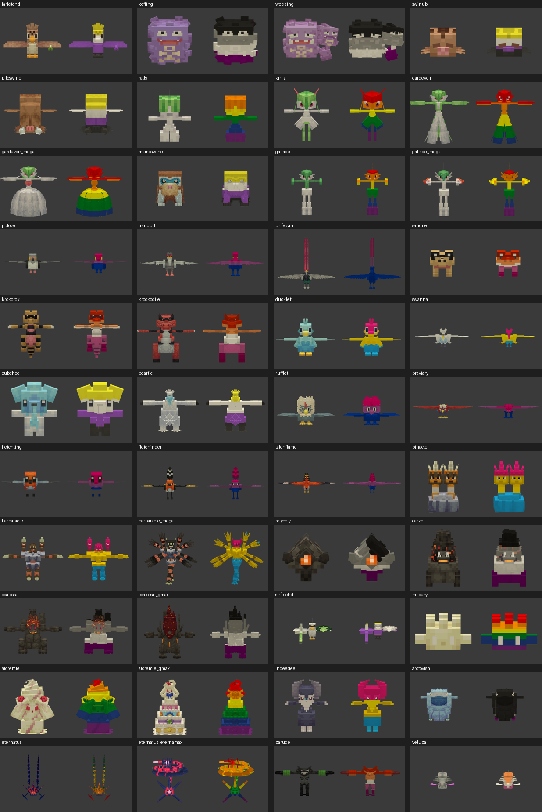

### How to get one

Give a supported Pokémon a **Copper Ingot** as its cosmetic item. With commands: `/pokegive durant steampunk`,
`/pokegive tepig steampunk shiny`. Pack makers can extend the item tag `#cobbleeffort:steampunk_cosmetics`.

## New Pokémon (CobbleEffort's own)

Original Pokémon from the user's designs (idea and look), with names, Pokédex entries, stats and moves made up for
them. Each one has a hand-built box model in Cobblemon's style, a shiny, animations (idle, walking, battle stance,
sleep, cry, moves, fainting), wild spawns, drops and a CobbleEffort page in the Pokédex. They use National Pokédex
numbers from #3001, which nothing else in the supported mod stack uses. In commands, use the namespaced id:
`/pokegive cobbleeffort:cavitot`.

**The dentistry line** (Cavitot, Amalgum, Orthodread): shinies have minty enamel (fresh toothpaste) and gold metal:
gold fillings, caps and braces.

**The coal butterfly line** (Coalarva, Cinderoon, Gatterfly) is CobbleEffort's **starter**: Coalarva has its own
"CobbleEffort" page on Cobblemon's starter screen (with Mumpillar, the water starter), after the regions. (Cobblemon shows only data-pack starter pages
once any exist, so CobbleEffort ships Cobblemon's own region pages too, exactly as in its default config: every usual
starter stays available. If your server turns on `useConfigStarters`, the CobbleEffort page is simply added to your
config's list.) Cinderoon's cocoon is a see-through ash layer with the Coalarva visible inside; their abdomens, the
cocoon's embers and bands, and Gatterfly's wings, cracks and gun barrels glow in the dark. Shinies burn with blue fire.

Gatterfly learns its own move when it evolves, **Machine Gun Stinger**: Bug, physical, 25 power, 95% accuracy, 15 PP,
hits 2-5 times (always 5 with its hidden ability Skill Link), each hit with a 20% chance to burn. It is a bullet move
(Bulletproof blocks it). Its Gatling drums spin when it attacks.

**The mantis line** (Prayling, Mawntis, Mantasma) is blind: none of them has eyes. Their own ability, **Blindsight**,
makes every move they use hit, whatever its accuracy and whatever evasion boosts the target has, and even targets
that are flying, underground or underwater (like No Guard, but only for its own moves). Prayling and Mawntis are
Grass/Bug; Mawntis evolves into the Grass/Ghost Mantasma at level 40 **at night**, and it learns Poltergeist as it
does. Mantasma's maw, ghost blades, leg rings and abdomen stripes glow in the dark. Shinies are orchid mantises: petal
pink and white, glowing violet.

**The mummy line** (Mumpillar, Sarcoon, Pharantis) is CobbleEffort's **water starter** (Water/Bug), on the
CobbleEffort starter page next to Coalarva: a bandaged mummy caterpillar, a cocoon shaped like a pharaoh's
sarcophagus, and a nimble mantis pharaoh. Their own ability, **Pharaoh's Curse**: once per battle, a hit that would
knock the Pokémon out doesn't. It rises again at half its HP (healed up to half if it was lower) and its Attack and Sp.
Atk rise by two stages. Their eyes glow. Shinies are turquoise and rose gold.

**Route one**: the everyday Pokémon you meet first, all common in plains, grasslands, forests and by rivers, with low
levels and early evolutions:
- **Pipider → Blanketula** (Bug/Grass, level 14): a super tiny spider wearing a seed as a shell, then a fuzzy spider
  clutching a big leaf like a safety blanket.
- **Shivnymph → Sheathalis → Cutlassfly** (Bug/Steel, levels 7 and 10): a baby dragonfly with a kitchen knife for a
  tail, a knife-block cocoon, and a huge dragonfly with knife-blade wings (Sharpness boosts its slicing moves).
- **Cardling → Rubraptor** (Fairy/Flying, level 22): a cute round cardinal, then a red-winged hawk (hidden ability
  Pixilate).
- **Squeakling → Elastigoose** (Water/Flying, level 25): a stout rubber ducky floating on rivers and ponds, then a
  long-necked rubber goose honking with its bill wide open.
- **Raddent → Rattlebunch** (Grass/Normal, level 20): a rat whose body is a radish, then a rat king of four radish rats
  with their leafy tops knotted together in twine.

**Fossils** (revived at Cobblemon's Fossil Analyzer and Restoration Tank, like any fossil):
- **Petroleodd → Petroleossil** (Rock, then Rock/Dragon; design by @aalacer398, used with permission): a pile of
  ancient tar brought back to life with old Pokémon bones inside, evolving at **level 45 while holding a King's Rock**
  into a massive mound of tar with a tyrant's fossil skull rising out of it. Its fossil, **Ancient Tar**, comes from
  **tar pits**: caverns deep underground (around y -30) with a pool of black tar beside pockets of lava. Brush the
  suspicious gravel round the tar.
- **Mycolith → Taxitower** (Rock/Poison, level 38; the Prototaxites idea came from Gemini): a petrified fungal
  stump that grows into an 8-metre spire venting golden spores. Its fossil, the **Spire Fossil**, comes from
  **petrified spire stumps** in forests and swamps: brush the suspicious gravel round them. Its own ability
  **Paleomycelium** gives its Grass-type moves the same-type bonus and makes it immune to Leech Seed and to powder and
  spore moves; its own move **Devonian Drift** (Poison, status, 15 PP) covers the foe's side in ancient spores for five
  turns, hurting every grounded opponent that isn't Poison or Steel type by 1/8 of its HP each turn and lowering its
  Speed.

Both fossil items are in the CobbleEffort creative tab.

**Jerbolt → Mesmerboa** (Electric/Psychic; design by NyonTox, used with permission): CobbleEffort's Pikachu-like
mice, after desert hopping mice (jerboas). They float, and their excessively long tails curl into a full ring round
them, banded yellow and violet (the violet glows) with a lightning-bolt tip; the ring turns round and round, slowly at
rest and faster on the move or in battle. Jerbolt has hypnotic spiral eyes. Use a **Thunder Stone** on Jerbolt to
evolve it (it learns Psychic Noise). Uncommon in deserts, badlands and savannas at night; Mesmerboa is rare in deserts
at night. Shinies are lilac with a cyan ring.

**Sharkindle → Forgnash → Magmalodon** (Steel/Fire, levels 40 and 60): CobbleEffort's **pseudo-legendary** (600 base
stats, slow growth). A red and black land shark on four legs with glowing orange fins; then a two-legged land shark with
huge red claws, more fins and flames exploding from its back; then a huge, beefy land shark with a fanged mouth that
glows inside, flames round its arms and legs, and smoke pouring off its head and hanging down its back like dreads.
Rough Skin or Flash Fire, hidden Tough Claws. Very rare in volcanic biomes, badlands and underground near lava.
Shinies are steel-silver and cobalt with blue flames.

**Jormbuoy → Jorminous** (Water → Water/Ghost; from the **Zorneo × Norden region** fakemon series, used with the
creators' permission): Jörmungandr crossed with a Viking raid ship. Jormbuoy is a little sea serpent that bobs like a
buoy under a longship's wooden hull, shields along its sides; use a **Dusk Stone** on it at **level 45 or higher** and
it becomes Jorminous, a huge coiled serpent with a head carved like a dragon prow, oar fins fraying into ghostly foam,
shields along its coils, mast-like spikes and a tail trailing glowing sea mist. Both swim and breathe underwater.
Jormbuoy floats on oceans (uncommon, more in cold seas); Jorminous rises on deep oceans at night (very rare).
Shinies are sea-green with pale birch planks.

**Type: Error** (shown as Normal; genderless, sub-legendary rarity): like Type: Null but bipedal and more evil, built
for heavy attacks and speed (130 Attack, 114 Speed; low defences). Its own ability **System Error** gives it the
**Error type** in battle: every move hits it for neutral damage except Normal-type moves, which are super effective, and
its own Normal-type moves hit everything for neutral damage (ghosts included) and are super effective on Normal types.
Cobblemon has no way to add a new type, so its summary shows Normal while the ability does the rest. A spiked brown
mask with one glaring eye, a white mane, a silver pincer claw and a huge blue fin club. Learns Extreme Speed and Close
Combat. Extremely rare in the Deep Dark. Shiny: violet with a gold mask and a magenta club.

**Tanhyll** (Normal/Fighting): a hunched, shaggy anteater standing on two legs, with a long curved snout, a hooked pink
tongue, big white claws and a bushy tail. Its own ability **Insectivore** makes all of its attacks extremely super
effective (4×) on Bug-type Pokémon, whatever their other type, and no type immunity protects a Bug type from them
(Shedinja's Wonder Guard and Levitate included). Hidden ability Scrappy. Learns Crush Claw, Hammer Arm and Close Combat.
Uncommon in savannas and jungles, rare in forests and badlands. Shiny: rusty brown and tan.

**Tikimp → Tikilla** (Normal/Fighting, level 32): kickboxing apes with skull and tiki looks. Tikimp is a little black
monkey with spiky hair, a white skull face with a golden grin, bone stripes and huge white mitts and feet; Tikilla is a
big ape with a white shaggy mane and enormous white fists carved like tiki masks. Iron Fist or Reckless, hidden
Scrappy; kicks galore (Double Kick, Jump Kick, Mega Kick, Trop Kick, and High Jump Kick when it evolves). Uncommon in
jungles, bamboo jungles, beaches and tropical islands; Tikilla is rare. Shiny: bone-white with black markings and jade.

**Mousense → Sensarat** (Normal, level 22): rodents whose eyes never open; they feel their way with long whiskers.
Mousense is a chubby cream mouse sitting up with big round dark ears, a buck tooth and pink paws and tail; Sensarat is
a round, shaggy brown ball of a rat with a cream face, yellow-lined ears and very long feeler whiskers. Frisk or
Anticipation, hidden Hustle; sensing moves (Foresight, Detect, Mind Reader, and Sucker Punch when it evolves) plus Hyper
Fang, Crunch and Super Fang. Mousense is common in plains, grasslands, forests and hills; Sensarat is uncommon in plains
and forests. Shiny: pale blue with a dark eye mask (Mousense); navy with a white fringe and whiskers (Sensarat).

**Gigantler** (Normal): a huge, long-legged moose with a stern glare, a zigzag stripe down each flank, cream legs and
three massive crown-like antlers: a broad palm spreading out to each side and a tall crown rising from the middle.
Intimidate or Sap Sipper, hidden Sheer Force; Horn Leech, Head Charge, Megahorn and High Horsepower. Rare in taigas and
snowy forests, rarer in swamps and tundra. Shiny: a pale "ghost" moose with golden antlers.

**Assoulsect** (Bug/Ghost): thousands of fallen Bug Pokémon bound into one hive mind by a zombie-ant fungus
(Ophiocordyceps): a violet fog-cloud of souls on two thin black legs, with the heads of the fallen sunk in it (a red
horned beetle face, a cricket head with long antennae, a gold ninja mask, a green rock-scaled head), their blades,
horns, lances and a wing bristling out, cordyceps stalks with glowing spore tips sprouting all over and wisps of souls
drifting off. Its own ability **Hive Mind**: a Bug-type foe's moves never harm it; the hive seizes them, and the attack
strikes the foe's own side instead (the attacker, or its partner in a double battle), while its status moves just
fail. Hidden ability Effect Spore. Very rare at night in dark forests, jungles, swamps and mushroom fields, and in lush
caves and the deep dark. Shiny: the fungus has won (mossy green fog, dark teal armour, silver, red-glowing spores).

**Capybrute** (Ground/Fighting): a huge, hunched rodent after capybaras and marmots, with a great arched back like a
boulder and two pale-orange slash markings along it, a small low head with a tan muzzle, a scowling orange brow and
big buck teeth, thick tan forelegs with dark claws, short dark hind legs and spiky fur at the rump and tail. Guts or
Thick Fat, hidden Unaware (it couldn't care less about your stat boosts); Super Fang, Drain Punch, High Horsepower,
Close Combat and Earthquake, and it learns Yawn. Uncommon by rivers, in swamps and savannas, and in hills, mountains
and highlands. Shiny: a silver marmot with icy blue markings.

**Writhing Rot** (Bug/Dragon), the ancient paradox of Sudowoodo: a hollow, rotting log on four gnarled root legs, with
Sudowoodo's orange zigzags, pink wounds and a pink ringed hollow at the front, out of which a long white segmented grub
of a neck writhes up to a skull-like head with glowing yellow eyes and curved orange mandibles; four white feelers curl
back from the log and a segmented tail trails behind. Protosynthesis; genderless, labelled paradox. Glare, Coil,
Lunge, Dragon Claw, Sucker Punch, Wood Hammer, First Impression, Outrage and Head Smash. Very rare in old-growth
forests and taigas, dark forests and jungles. Shiny: a pale birch log with mint and lime and a creamy yellow grub.

<!-- newmons:start -->
| # | Pokémon | Types | Abilities | HP / Atk / Def / SpA / SpD / Spe | Height / Weight | How to get it | Pokédex |
|---|---|---|---|---|---|---|---|
| 3001 | **Cavitot** | Dark | Strong Jaw / Stench / Stakeout (hidden) | 50 / 65 / 60 / 30 / 45 / 50 | 2'4" (0.7 m) / 18.5 kg | Wild: common near sugar cane (sugar rots teeth) and in Dripstone Caves, uncommon underground and in villages at night. Evolves into Amalgum at level 24. | It started out as a baby tooth that was never brushed. The cavity in its crown aches all the time, which is why it always looks so grumpy. It can't resist sweets, even though they make the ache worse. |
| 3002 | **Amalgum** | Dark / Steel | Strong Jaw / Sturdy / Stakeout (hidden) | 65 / 85 / 95 / 40 / 60 / 55 | 3'7" (1.1 m) / 72.4 kg | Evolve Cavitot at level 24. Wild: uncommon in Dripstone Caves, rare in the Deep Dark. | Three Cavitot that had their cavities filled and fused into one. The metal in their fillings makes it tough to crack, but all three of its faces still frown. It gnaws on iron ore to keep its caps shiny. |
| 3003 | **Orthodread** | Dark / Steel | Strong Jaw / Iron Barbs / Stakeout (hidden) | 85 / 120 / 120 / 50 / 80 / 70 | 5'11" (1.8 m) / 205 kg | Evolve Amalgum at level 42. Wild: very rare in the Deep Dark and Dripstone Caves. | Eight teeth held together by braces it can never take off. It scuttles through dark caves on its steel legs and its bite can crunch through iron. The braces put it in a foul mood, and it takes that out on anyone it meets. |
| 3004 | **Coalarva** | Fire / Bug | Blaze / Skill Link (hidden) | 45 / 55 / 50 / 49 / 50 / 60 | 1'4" (0.4 m) / 12 kg | The CobbleEffort starter: pick it at the starter screen (its own CobbleEffort page, after Cobblemon's regions). Wild: very rare underground next to coal ore. Evolves into Cinderoon at level 16. | It lives in caves deep underground where coal seams run thick, and it eats nothing but coal. A special organ in its abdomen turns the minerals it swallows into heat, which is why its tail end always glows. |
| 3005 | **Cinderoon** | Fire / Bug | Blaze / Skill Link (hidden) | 60 / 45 / 95 / 60 / 85 / 60 | 3'3" (1 m) / 38.5 kg | Evolve Coalarva at level 16. | Once it has eaten enough coal, it wraps its soft body in a cocoon of cinders. The ash is thin enough to see the Coalarva curled up inside, and it can burn some of it away to hurl a blast of fire at anything that disturbs it. |
| 3006 | **Gatterfly** | Fire / Bug | Blaze / Skill Link (hidden) | 78 / 115 / 80 / 104 / 75 / 82 | 5'7" (1.7 m) / 125 kg | Evolve Cinderoon at level 36. Learns its own move, Machine Gun Stinger, when it evolves. | Its arms have become guns that spray stingers so fast and so hot they glow, and its wings are made of fire. Besides fighting with them, it melts stone with its flames to build its nest. |
| 3007 | **Prayling** | Grass / Bug | Blindsight (its own: every move it uses hits) / Sniper (hidden) | 45 / 60 / 40 / 35 / 40 / 55 | 1'4" (0.4 m) / 2.2 kg | Wild: common in jungles, uncommon in flower forests, meadows and forests. Evolves into Mawntis at level 22. | It is born without eyes, yet it never misses. It feels the faintest stir of air through its leafy feelers and knows exactly where its prey is, then holds its little forelegs together and waits. |
| 3008 | **Mawntis** | Grass / Bug | Blindsight (its own: every move it uses hits) / Sniper (hidden) | 65 / 95 / 65 / 45 / 60 / 80 | 3'7" (1.1 m) / 38 kg | Evolve Prayling at level 22. Wild: rare in jungles. | Its head has split into a maw full of fangs, and a second set of legs lets it run down prey in the undergrowth. It still has no eyes, but its scythes find their mark every time. |
| 3009 | **Mantasma** | Grass / Ghost | Blindsight (its own: every move it uses hits) / Sniper (hidden) | 90 / 130 / 90 / 70 / 85 / 75 | 11'6" (3.5 m) / 210 kg | Evolve Mawntis at level 40 or higher at night. Wild: very rare in dark forests and jungles at night. | A Mawntis that hunted on a moonless night and came back as something else. It towers over the trees, its grin glows in the dark, and its ghostly scythes cut through anything without ever missing. Even so, it still clasps its forelegs together the way it did as a Prayling. |
| 3010 | **Mumpillar** | Water / Bug | Pharaoh's Curse (its own: once per battle, survives a knockout at half health with +2 Attack and Sp. Atk) / Torrent (hidden) | 50 / 52 / 48 / 52 / 57 / 50 | 1'4" (0.4 m) / 9.5 kg | A CobbleEffort starter: pick it at the starter screen (the CobbleEffort page, with Coalarva). Wild: very rare in deserts next to water (an oasis). Evolves into Sarcoon at level 16. | It wraps itself in strips of silk soaked in river water and never takes them off. Old tales say anyone who unwraps one is cursed, and that it cannot be finished off: struck down, it rises again angrier than before. |
| 3011 | **Sarcoon** | Water / Bug | Pharaoh's Curse (its own: once per battle, survives a knockout at half health with +2 Attack and Sp. Atk) / Torrent (hidden) | 65 / 55 / 100 / 55 / 90 / 40 | 3'3" (1 m) / 41 kg | Evolve Mumpillar at level 16. | Its silk hardens into a coffin painted like a pharaoh's. It lies still for weeks, but anything foolish enough to pry at the lid wakes the curse, and the case's eyes light up. |
| 3012 | **Pharantis** | Water / Bug | Pharaoh's Curse (its own: once per battle, survives a knockout at half health with +2 Attack and Sp. Atk) / Torrent (hidden) | 75 / 110 / 70 / 100 / 74 / 105 | 5'3" (1.6 m) / 62 kg | Evolve Sarcoon at level 36. Learns Liquidation when it evolves. | It rules the river valleys with a crook of gold at the end of each scythe, and moves so fast its foes never see it strike. Those who think they have defeated it soon learn about the pharaoh's curse. |
| 3013 | **Pipider** | Bug / Grass | Shell Armor / Swarm / Seed Sower (hidden) | 40 / 40 / 50 / 25 / 35 / 30 | 0'4" (0.1 m) / 0.2 kg | Wild: common in plains, grasslands and forests. Evolves into Blanketula at level 14. | One of the smallest Pokémon there is: it fits on a fingertip. It hides under a seed it found and carries it everywhere like a shell, and when it is frightened it tucks its legs in and pretends to be an ordinary seed. |
| 3014 | **Blanketula** | Bug / Grass | Shell Armor / Swarm / Seed Sower (hidden) | 65 / 80 / 75 / 45 / 70 / 55 | 1'8" (0.5 m) / 8.5 kg | Evolve Pipider at level 14. Wild: uncommon in forests. | When it outgrows its seed it picks out a big leaf and never lets go of it again. It sleeps wrapped up in it, hides under it when anything startles it, and grows very upset if the leaf is taken away. |
| 3015 | **Shivnymph** | Bug / Steel | Sharpness / Swarm / Speed Boost (hidden) | 40 / 50 / 40 / 20 / 30 / 45 | 1'0" (0.3 m) / 3 kg | Wild: common by rivers and in plains. Evolves into Sheathalis at level 7. | It hatches near water with a tiny blade already at the end of its tail. It keeps the edge sharp by scraping it on river stones, and flicks it at anything that comes too close. |
| 3016 | **Sheathalis** | Bug / Steel | Sharpness / Swarm / Speed Boost (hidden) | 45 / 35 / 85 / 25 / 50 / 25 | 2'0" (0.6 m) / 20 kg | Evolve Shivnymph at level 7. Wild: uncommon by rivers and in plains. | Its cocoon hardens into something like a block of wood with knife handles sticking out of it. The blades inside are its new wings growing, and it peeks out of the front to keep watch. |
| 3017 | **Cutlassfly** | Bug / Steel | Sharpness / Swarm / Speed Boost (hidden) | 70 / 110 / 80 / 40 / 60 / 115 | 5'3" (1.6 m) / 48 kg | Evolve Sheathalis at level 10. Wild: rare by rivers and in swamps. | Its wings are blades sharp enough to slice falling leaves in two. It hovers perfectly still over rivers, then darts away faster than the eye can follow, leaving cut reeds behind it. |
| 3018 | **Cardling** | Fairy / Flying | Keen Eye / Cute Charm / Pixilate (hidden) | 40 / 40 / 40 / 45 / 50 / 60 | 1'0" (0.3 m) / 1.8 kg | Wild: common in forests, plains and grasslands. Evolves into Rubraptor at level 22. | It sings sweetly from the branches at dawn, and its song is said to bring good luck to anyone who hears it first thing in the morning. It is tiny, round and fearless. |
| 3019 | **Rubraptor** | Fairy / Flying | Keen Eye / Cute Charm / Pixilate (hidden) | 70 / 80 / 65 / 85 / 70 / 95 | 3'7" (1.1 m) / 26 kg | Evolve Cardling at level 22. Wild: rare in forests and hills. | A proud hawk that guards its territory from the treetops. Its red wings flash like a warning as it dives, yet it is gentle with Pokémon smaller than itself and shares its catch with them. |
| 3020 | **Squeakling** | Water / Flying | Water Veil / Own Tempo / Unaware (hidden) | 45 / 35 / 45 / 40 / 45 / 45 | 0'8" (0.2 m) / 1.5 kg | Wild: common floating on rivers, ponds and swamps. Evolves into Elastigoose at level 25. | It bobs along on rivers and ponds without a care, and squeaks whenever it is squeezed. Its body is light and springy, so it never sinks, however rough the water. |
| 3021 | **Elastigoose** | Water / Flying | Water Veil / Own Tempo / Unaware (hidden) | 80 / 70 / 70 / 80 / 70 / 75 | 4'11" (1.5 m) / 22 kg | Evolve Squeakling at level 25. Wild: uncommon on rivers, ponds and swamps. | Its neck stretches like rubber, letting it snatch food from the riverbed or honk right in a foe's face from far away. Its honk is so loud it can be heard three valleys over. |
| 3022 | **Raddent** | Grass / Normal | Run Away / Harvest / Guts (hidden) | 35 / 56 / 35 / 25 / 35 / 72 | 1'0" (0.3 m) / 4 kg | Wild: common in plains, grasslands, forests and villages. Evolves into Rattlebunch at level 20. | It plants itself in a vegetable patch and pretends to be a radish until the farmer goes home, then nibbles everything in sight. Pull on its leaves and it squeaks and bolts. |
| 3023 | **Rattlebunch** | Grass / Normal | Run Away / Harvest / Guts (hidden) | 75 / 88 / 70 / 50 / 70 / 97 | 2'7" (0.8 m) / 18 kg | Evolve Raddent at level 20. Wild: rare in plains and grasslands. | Several Raddent whose leaves grew tangled together in the same patch, tied fast with a farmer's twine. They argue constantly about which way to run, but when they agree, nothing can catch them. |
| 3024 | **Petroleodd** | Rock | Gooey / Sticky Hold / Rock Head (hidden) | 70 / 60 / 80 / 55 / 65 / 30 | 2'0" (0.6 m) / 41 kg | Revive Ancient Tar at a Restoration Tank. Ancient Tar is found by brushing the suspicious gravel round the tar pools of tar pits, caverns deep underground (around y -30) beside pockets of lava. Evolves into Petroleossil at level 45 while holding a King's Rock. | A pile of tar from the bottom of an ancient tar pit, brought back to life with the bones of old Pokémon still inside it. It is sleepy and slow, and anything that touches it comes away stuck. |
| 3025 | **Petroleossil** | Rock / Dragon | Gooey / Sticky Hold / Rock Head (hidden) | 110 / 115 / 110 / 75 / 90 / 40 | 13'1" (4 m) / 420 kg | Evolve Petroleodd at level 45 while it holds a King's Rock (the King's Rock is used up). | Holding a King's Rock, Petroleodd swallows tar and sludge until it becomes a mountain of it, with the fossil skull of an ancient tyrant floating up through the middle. It roars through its jaws. |
| 3026 | **Mycolith** | Rock / Poison | Paleomycelium (its own: Grass moves get STAB; immune to Leech Seed, powder and spore moves) / Effect Spore (hidden) | 80 / 50 / 90 / 65 / 60 / 20 | 3'7" (1.1 m) / 83.9 kg | Revive a Spire Fossil at a Restoration Tank. Spire Fossils are found by brushing the suspicious gravel round petrified spire stumps in forests and swamps. Evolves into Taxitower at level 38. | Revived from the Spire Fossil. Over 400 million years ago, fields of Mycolith dominated the barren land before true trees ever took root. Researchers originally mistook its fossilized remains for ancient timber. |
| 3027 | **Taxitower** | Rock / Poison | Paleomycelium (its own: Grass moves get STAB; immune to Leech Seed, powder and spore moves) / Effect Spore (hidden) | 115 / 70 / 125 / 95 / 85 / 25 | 26'3" (8 m) / 644.1 kg | Evolve Mycolith at level 38. | Towering over ancient swamps, Taxitower absorbed nutrients from the surrounding soil through miles of underground threads. When threatened, it releases blinding clouds of prehistoric spores that haven't been breathed in eons. |
| 3028 | **Jerbolt** | Electric / Psychic | Static / Synchronize / Levitate (hidden) | 40 / 45 / 35 / 60 / 45 / 85 | 1'0" (0.3 m) / 2.5 kg | Wild: uncommon in deserts, badlands and savannas at night. Evolves into Mesmerboa when a Thunder Stone is used on it. | It floats over desert dunes at night with its tail curled round it in a ring. Anything that stares at the turning ring for long falls into a daze, and Jerbolt hops off with its food. |
| 3029 | **Mesmerboa** | Electric / Psychic | Static / Synchronize / Levitate (hidden) | 60 / 65 / 55 / 105 / 85 / 125 | 2'4" (0.7 m) / 14 kg | Use a Thunder Stone on Jerbolt. It learns Psychic Noise when it evolves. Wild: rare in deserts at night. | Its tail is so long it never touches the ground: it hangs round Mesmerboa in a great ring that crackles with electricity. Spun fast, the ring can put a whole herd of Pokémon to sleep at once. |
| 3030 | **Sharkindle** | Steel / Fire | Rough Skin / Flash Fire / Tough Claws (hidden) | 55 / 70 / 55 / 40 / 45 / 35 | 2'4" (0.7 m) / 30 kg | Wild: very rare in volcanic biomes and badlands, and underground near lava. Evolves into Forgnash at level 40. | It swims through the ground near lava as easily as a shark through water, its orange fins glowing where they cut through the hot rock. Its bite can dent iron. |
| 3031 | **Forgnash** | Steel / Fire | Rough Skin / Flash Fire / Tough Claws (hidden) | 70 / 100 / 80 / 55 / 60 / 55 | 4'7" (1.4 m) / 120 kg | Evolve Sharkindle at level 40. Wild: extremely rare in volcanic biomes. | Once it stands on two legs, the fire inside it bursts out through its back. It hammers metal ore with its claws to sharpen them, and the sparks fly like a forge. |
| 3032 | **Magmalodon** | Steel / Fire | Rough Skin / Flash Fire / Tough Claws (hidden) | 108 / 135 / 105 / 80 / 85 / 87 | 7'10" (2.4 m) / 350 kg | Evolve Forgnash at level 60. | Its body burns hotter than a smelter, and the smoke pouring off its head hangs down its back like dreadlocks. A single bite from its huge jaws can tear through a steel girder. |
| 3033 | **Jormbuoy** | Water | Swift Swim / Shell Armor / Cursed Body (hidden) | 60 / 50 / 65 / 60 / 60 / 45 | 2'4" (0.7 m) / 22 kg | Wild: uncommon floating on oceans, especially cold ones. Evolves into Jorminous when a Dusk Stone is used on it at level 45 or higher. | It bobs along on cold seas under a hull of old ship's timbers, shields lined up along its sides. Sailors used to tie their boats to it, mistaking it for a buoy, until it swam away with them. |
| 3034 | **Jorminous** | Water / Ghost | Swift Swim / Shell Armor / Cursed Body (hidden) | 95 / 90 / 95 / 100 / 90 / 70 | 23'0" (7 m) / 300 kg | Use a Dusk Stone on Jormbuoy at level 45 or higher. It learns Hex when it evolves. Wild: very rare on deep oceans at night. | The ghost of a sunken raiding ship that has become a great sea serpent. When it rises out of the fog with its shields gleaming and its oars beating, whole fleets turn back to shore. |
| 3035 | **Type: Error** | Normal | System Error (its own: makes it Error type in battle) | 80 / 130 / 60 / 90 / 60 / 114 | 6'3" (1.9 m) / 120.5 kg | Wild: extremely rare in the Deep Dark (level 50-60). Genderless; it cannot breed. | A failed experiment built to be faster and deadlier than any other. The mask clamped over its head keeps its corrupted power in check. Its type cannot be read: every attack hits it the same, except the most ordinary ones. |
| 3036 | **Tanhyll** | Normal / Fighting | Insectivore (its own: its attacks are 4x super effective on Bug types) / Scrappy (hidden) | 90 / 115 / 75 / 55 / 70 / 85 | 5'3" (1.6 m) / 70 kg | Wild: uncommon in savannas and jungles, rare in forests and badlands. | It stands up on its hind legs to tear open Bug Pokémon nests with its huge claws, then slurps up everything inside with its long hooked tongue. Bug Pokémon flee at its very scent. |
| 3037 | **Tikimp** | Normal / Fighting | Iron Fist / Reckless / Scrappy (hidden) | 55 / 75 / 45 / 35 / 45 / 70 | 2'0" (0.6 m) / 16 kg | Wild: uncommon in jungles, bamboo jungles, beaches and tropical islands. Evolves into Tikilla at level 32. | It paints its face like a skull to scare off bigger Pokémon, then kickboxes anything that isn't scared. It practises its kicks on bamboo all day long and never seems to tire. |
| 3038 | **Tikilla** | Normal / Fighting | Iron Fist / Reckless / Scrappy (hidden) | 85 / 125 / 80 / 50 / 70 / 95 | 6'7" (2 m) / 145 kg | Evolve Tikimp at level 32. It learns High Jump Kick when it evolves. Wild: rare in jungles and on tropical islands. | Its fists have grown as big as tiki masks, and it carves faces into them to look fiercer. It leads its troop with thundering kicks and shakes its great white mane to warn rivals away. |
| 3039 | **Mousense** | Normal | Frisk / Anticipation / Hustle (hidden) | 40 / 50 / 35 / 35 / 40 / 75 | 1'0" (0.3 m) / 2.5 kg | Wild: common in plains, grasslands, forests and hills. Evolves into Sensarat at level 22. | Its eyes stay shut from the day it hatches. It feels its way about with its long whiskers, which can pick up the flutter of a moth's wings across a meadow, so sneaking up on it is near impossible. |
| 3040 | **Sensarat** | Normal | Frisk / Anticipation / Hustle (hidden) | 70 / 85 / 65 / 50 / 70 / 105 | 2'0" (0.6 m) / 14 kg | Evolve Mousense at level 22. It learns Sucker Punch when it evolves. Wild: uncommon in plains and forests. | It sweeps its long whiskers through the dark like feelers and senses an attack before it comes, striking first. It never opens its eyes; those who have seen them say they are as bright as stars. |
| 3041 | **Gigantler** | Normal | Intimidate / Sap Sipper / Sheer Force (hidden) | 105 / 120 / 100 / 50 / 80 / 70 | 7'10" (2.4 m) / 620 kg | Wild: rare in taigas and snowy forests, rarer in swamps and tundra. | The antlers on its head grow back bigger every year, and an old bull's three crowns can span wider than a cabin. Packs of predators turn back the moment it lowers its head, and travellers in the northern woods take a glimpse of one as a sign of good fortune. |
| 3042 | **Assoulsect** | Bug / Ghost | Hive Mind (its own: a Bug-type foe's moves never harm it and strike the foe's side instead) / Effect Spore (hidden) | 90 / 125 / 95 / 85 / 95 / 70 | 7'3" (2.2 m) / 166.6 kg | Wild: very rare at night in dark forests, jungles, swamps and mushroom fields, and in lush caves and the deep dark. | When thousands of Bug Pokémon perished, a fungus took root in what was left of them and wove their souls into one mind. Their old heads and blades still twitch in its fog; any Bug Pokémon that challenges it is pulled into the hive and turns on its own allies. |
| 3043 | **Capybrute** | Ground / Fighting | Guts / Thick Fat / Unaware (hidden) | 110 / 120 / 105 / 40 / 75 / 50 | 4'11" (1.5 m) / 152 kg | Wild: uncommon by rivers, in swamps and savannas, and in hills, mountains and highlands. | It lounges by rivers as calmly as a boulder and lets other Pokémon nap on its back, but it digs burrows through solid rock with those claws. Rile it and it charges with its head down, shrugging off blows that would flatten a house. |
| 3044 | **Writhing Rot** | Bug / Dragon | Protosynthesis | 95 / 135 / 105 / 70 / 75 / 90 | 7'10" (2.4 m) / 182 kg | Wild: very rare in old-growth forests and taigas, dark forests and jungles. | An ancient Pokémon said to be the distant past of Sudowoodo, described in an old expedition journal. Its log body is only a shell: the real Pokémon is the pale, writhing thing that lives inside it, and it lunges out on a long neck to snatch prey. |
<!-- newmons:end -->


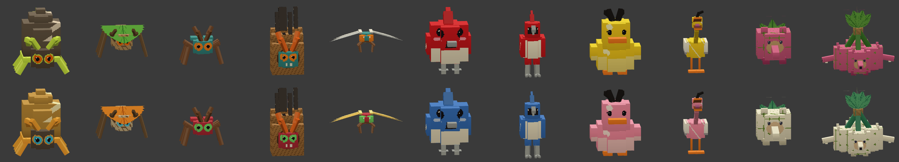

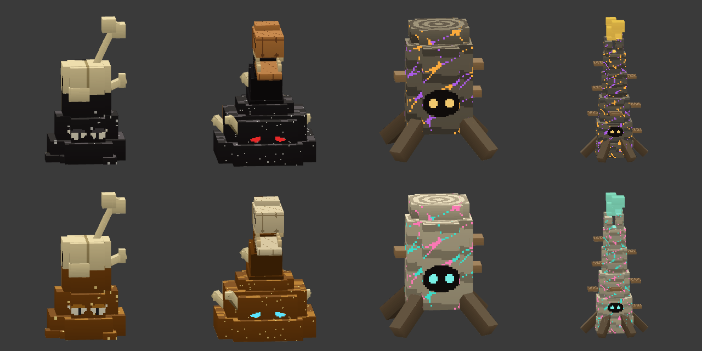

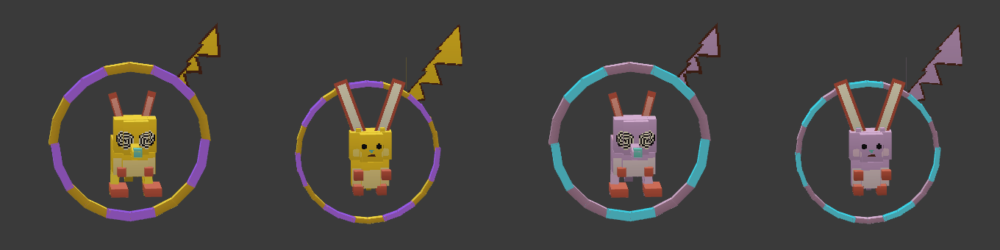

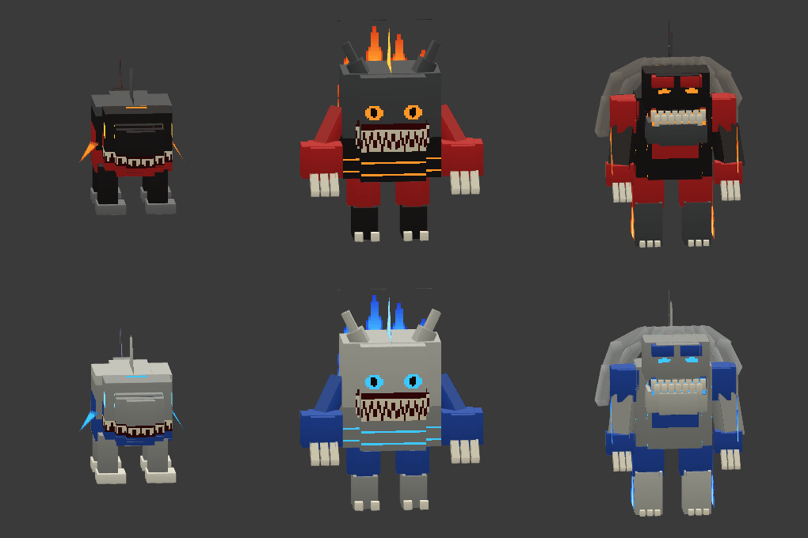

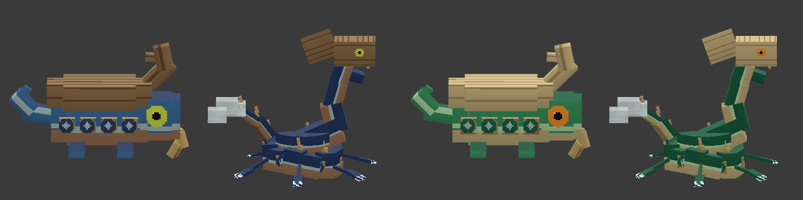

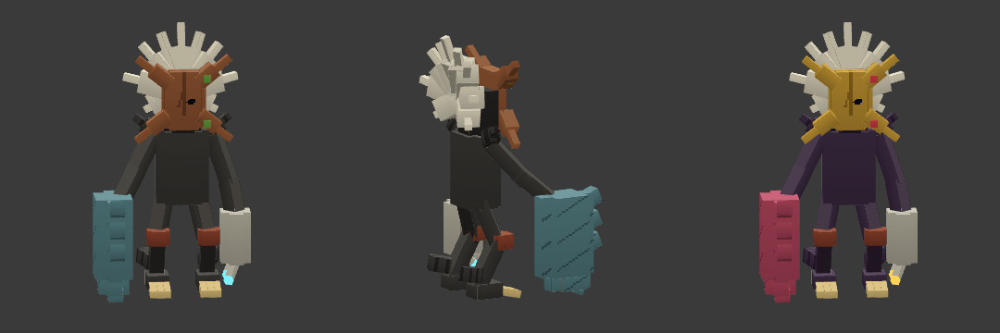

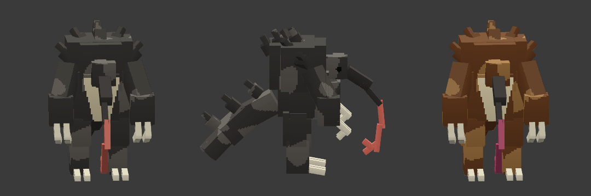

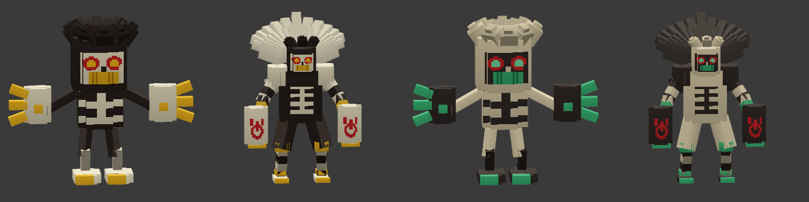

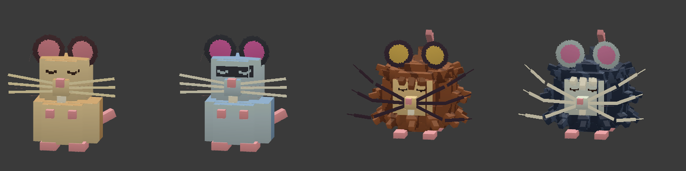

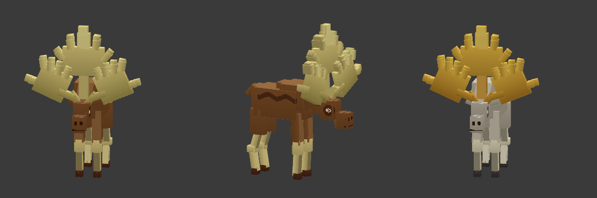

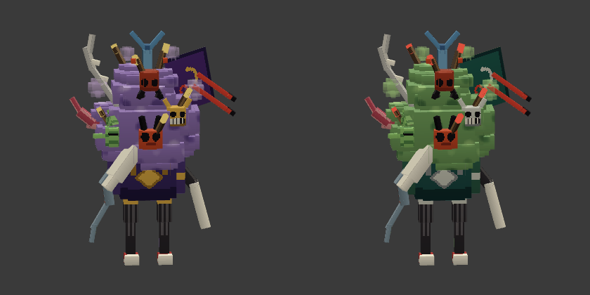

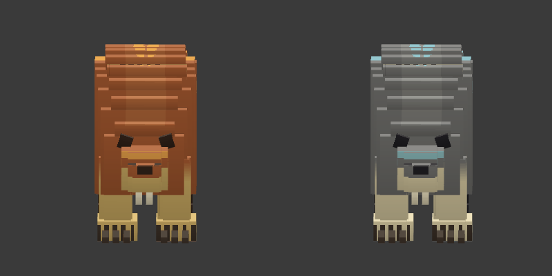

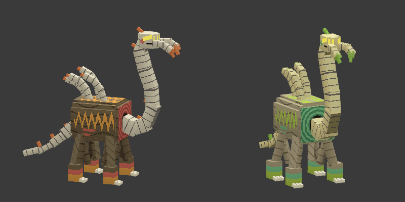

## CobbleEffort regional forms

Existing Pokémon lines with a form of their own, like Cobblemon's Alolan or Galarian forms: the aspect
`cobbleeffortian` (e.g. `/pokespawn caterpie cobbleeffortian`), the form "CobbleEffort", on Cobblemon's own models with
new textures, types, abilities, moves and Pokédex entries. Each evolves into the next CobbleEffort form.

**The Caterpie line** (Bug/Poison), after the CobbleEffort Caterpie art by **@MerphISC**: inspired by toxic wild
caterpillars that wear vibrant colours to warn predators away. Caterpie is purple with a pink forked feeler, a cream
belly and a curled yellow tail tip (Poison Point / Run Away; learns Poison Sting); Metapod's purple shell is studded with
bright yellow warning spots (Poison Point / Shed Skin; Acid Armor); Butterfree has violet wings with dark veins and
yellow warning spots, a plum body and yellow eyes (Poison Touch / Tinted Lens; Acid Spray, Venoshock, Sludge Bomb,
Toxic, Toxic Spikes and Quiver Dance). Caterpie is common in jungles, swamps, flower forests and dark forests, Metapod
uncommon and Butterfree rare there. Shiny: electric blue with orange.

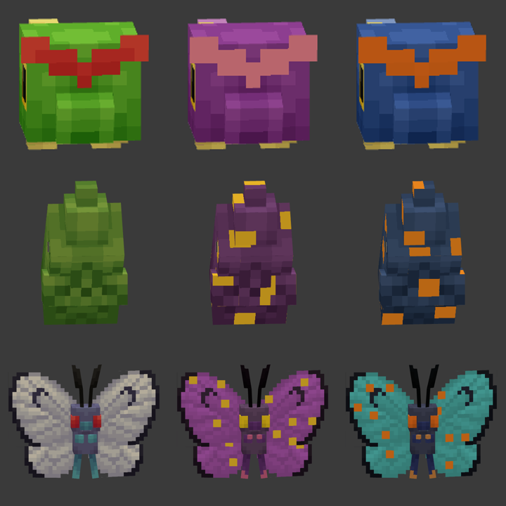

## Paradox Mega Evolutions (with Mega Showdown)

Every Paradox Pokémon (the 22 the Pokémon Fandom wiki lists: 11 Ancient including Koraidon, 11 Future including
Miraidon) gets a Mega Evolution through **Mega Showdown**, with a mega stone you can craft in survival. Each model is
hand-built from boxes in Cobblemon's style (bones and boxes placed by hand, clean painted textures with soft shading,
a glow layer where it glows) and has animations for idle, walking (or floating), battle stance, sleep, cry,
physical/special/status moves and fainting. Each mega adds 100 base stats and keeps its types; Ancient megas' stats
stay odd and Future megas' even, like the Paradox Pokémon's own. Shinies have their own colours.

<!-- megas:start -->
| Mega | Era | Types | Ability | HP / Atk / Def / SpA / SpD / Spe | Stone | Look |
|---|---|---|---|---|---|---|
| Mega Great Tusk | Ancient | Ground / Fighting | Tough Claws | 115 / 171 / 171 / 53 / 53 / 107 | Great Tuskite | heavy navy armour with glowing crimson seams over shaggy pale-blue fur, crimson crystals from head to tail, red fur cuffs, ivory claws and great double-curled tusks |
| Mega Scream Tail | Ancient | Fairy / Psychic | Punk Rock | 115 / 65 / 129 / 95 / 135 / 131 | Scream Tailite | punk rock: a tall swooshing crest streaked with magenta, star cheek marks, big yellow eyes and a fang, a fluffy collar and a long tail ending in a big curl |
| Mega Brute Bonnet | Ancient | Grass / Dark | Grassy Surge | 121 / 167 / 129 / 79 / 129 / 45 | Brute Bonnetite | a towering prototaxite: a pale ringed trunk with glowing shelf fungi, stubby root legs and arms gripping mushroom-cap shields, two glaring eyes and a fanged mouth, under a huge brown cap with red and grey spiked panels and long hanging moss |
| Mega Flutter Mane | Ancient | Ghost / Fairy | Levitate | 75 / 55 / 75 / 175 / 155 / 135 | Flutter Manite | two tiers of feathered mane-wings with glowing pink tips, a crown of red spikes, glaring red-and-yellow eyes, a glowing bead necklace and a long tattered skirt |
| Mega Slither Wing | Ancient | Bug / Fighting | Moxie | 85 / 175 / 109 / 85 / 115 / 101 | Slither Wingite | six blazing flame wings with glowing yellow tips and glowing green diamonds, a big white fluffy collar, a red horned head with one yellow eye, a teal tail and little dark legs |
| Mega Sandy Shocks | Ancient | Electric / Ground | Magnet Pull | 85 / 81 / 127 / 161 / 105 / 111 | Sandy Shockite | three grey Magneton spheres with yellow eyes and screws, great magnet arches with red and blue tips crackling with glowing yellow arcs, black iron-sand spikes everywhere and a spiked iron-sand crown |
| Mega Roaring Moon | Ancient | Dragon / Dark | Intimidate | 105 / 179 / 91 / 55 / 121 / 139 | Roaring Moonite | a lean blue dragon with a swept white crest and yellow chest mark, its crimson wings swept round into a blood-moon crescent edged with light-blue spikes and a glowing rim, black wingtips and red claws |
| Mega Koraidon | Ancient | Fighting / Dragon | Tough Claws | 100 / 175 / 135 / 85 / 120 / 155 | Koraidonite | a red bipedal dragon whose feather crest flares into a blazing crown with glowing orange tips, a black chest plate glowing like molten orichalcum, white feather fans at its sides, long white antennae and a feathered tail |
| Mega Walking Wake | Ancient | Water / Dragon | Drizzle | 99 / 83 / 111 / 165 / 103 / 129 | Walking Wakite | a teal four-legged dragon with a purple mane surging up like a breaking wave, glowing red and orange flame streaks, a tall teal crest fin, white muzzle, whiskers and claws, and a long white tail streaming in two ribbons |
| Mega Gouging Fire | Ancient | Fire / Dragon | Drought | 105 / 155 / 141 / 65 / 113 / 111 | Gouging Firite | a stocky brown beast with glowing magma cracks in its fur, black anklets, a red face mask with white fangs, a billowing grey smoke mane and a huge golden crest of curved spikes with glowing fiery tips |
| Mega Raging Bolt | Ancient | Electric / Dragon | Electric Surge | 125 / 73 / 111 / 177 / 109 / 95 | Raging Boltite | a long-necked yellow dragon striped black with a white neck and belly, red-and-blue feet, a towering purple thunderhead crackling with glowing lightning on its head, and a big glowing crystal ball on its teal tail |
| Mega Iron Treads | Future | Ground / Steel | Steelworker | 90 / 142 / 150 / 72 / 90 / 126 | Iron Treadite | a grey robot Donphan under two black tread wheels with glowing red panels, long black tusk-blades and a glowing red visor |
| Mega Iron Bundle | Future | Ice / Water | Snow Warning | 56 / 80 / 114 / 164 / 90 / 166 | Iron Bundlite | a robot Delibird with a tall spiky white crest, glowing blue goggle eyes, a red body with a white zigzag collar, red flippers and a great glowing blue ice-cannon ring on its back |
| Mega Iron Hands | Future | Fighting / Electric | Iron Fist | 154 / 180 / 138 / 50 / 98 / 50 | Iron Handite | a round grey robot with a navy belly and legs, a small helmeted head with a glowing visor, shoulder pylons and colossal piston hands with glowing yellow fingers |
| Mega Iron Jugulis | Future | Dark / Flying | Levitate | 94 / 80 / 106 / 162 / 100 / 128 | Iron Jugulite | a black robot Hydreigon with a glowing blue visor, glowing pink spike rings round its arm-heads, long black blade wings and a pink-and-blue segmented tail |
| Mega Iron Moth | Future | Fire / Poison | Corrosion | 80 / 70 / 80 / 180 / 130 / 130 | Iron Mothite | a robot Volcarona in a halo of eight glowing orange wing panels with dark triangle marks, a white mask face with black markings, a crest of red horns and a pale body with a black shell |
| Mega Iron Thorns | Future | Rock / Electric | Sand Stream | 100 / 174 / 140 / 70 / 104 / 82 | Iron Thornite | a lime-green robot Tyranitar with glowing teal windows, a black belly, a tall spiked crest and a fortress of spikes down its back and tail |
| Mega Iron Valiant | Future | Fairy / Fighting | Justified | 74 / 160 / 100 / 150 / 70 / 136 | Iron Valiantite | a white and green robot knight with a tall glowing green crest-blade, a red eye, long white arm-blades edged in glowing pink and a flowing cape of green blades |
| Mega Miraidon | Future | Electric / Dragon | Transistor | 100 / 85 / 120 / 175 / 135 / 155 | Miraidonite | a dark purple robot dragon traced with glowing yellow and cyan lines, wings of light flaring from its back, crackling lightning antennae and a long tail with a lightning tip |
| Mega Iron Leaves | Future | Grass / Psychic | Sharpness | 90 / 170 / 108 / 70 / 128 / 124 | Iron Leafite | a green robot Virizion with pink accents, a crest of glowing sword-horns, long leaf-blades at its shoulders, grey joints and four long legs with pink-edged hooves |
| Mega Iron Boulder | Future | Rock / Psychic | Solid Rock | 90 / 160 / 100 / 68 / 128 / 144 | Iron Boulderite | a sturdy robot Terrakion: a round dark torso ringed with glowing orange armour, a helmeted head with cat-ear points, a long white-hot blade-horn and grey legs with glowing orange rings |
| Mega Iron Crown | Future | Steel / Psychic | Psychic Surge | 90 / 72 / 120 / 162 / 128 / 118 | Iron Crownite | a teal robot Cobalion with grey joints and white tufts, its crest-blades spread into a crown of floating glowing golden swords round its head |
<!-- megas:end -->

**Getting a stone:** craft it: a Mega Showdown Mega Stone in the middle, a Diamond below, and themed items around
it (the recipes are in the zip's README). The stones are also in the CobbleEffort creative tab. Then do it the Mega
Showdown way: the Pokémon holds the stone, you wear a Mega Bracelet, and you press Mega Evolve in battle.


How it works without code: Mega Showdown reads megas from data (`data/<ns>/mega_showdown/mega/*.json`), Showdown
items from `data/<ns>/mega_showdown/showdown/held_items/*.js`, and treats any item stack carrying its components
`mega_showdown:registry_type_component: "mega"` and `mega_showdown:registry_location_component: <mega id>` as that
mega's stone. So each stone is an amethyst shard with those components (plus a name, lore and `custom_model_data`
for its own icon), made by a crafting recipe. The "Mega" forms are added with `species_additions`. Built by
`tools/megas/build.py` from the models in `tools/megas/models/`.

## Compatibility

CobbleEffort is built to be used alongside this mod stack, and every update is generated against it:

| Mod | What CobbleEffort does with it |
|-----|--------------------------------|
| **Mega Showdown** | Every mega, Gigantamax, Eternamax and mode form (e.g. Mega Charizard X/Y, Gmax Snorlax, Xerneas' active mode) of a Pokémon in a collection gets its own cosmetic texture, adapted from Mega Showdown's (CC BY-NC-SA 4.0). Where Mega Showdown replaces a Cobblemon model or texture (Audino, Latias, Xerneas…), the cosmetic follows its version |
| **Mega Showdown: Extra Megas** | Its megas (Torterra, Luxray, Gogoat, Annihilape…) get cosmetic textures too |
| **Mega Showdown Ores** | Nothing to change (no Pokémon visuals) |
| **AllTheMons x Mega Showdown** | It replaces some Cobblemon models (Absol, Typhlosion, Rolycoly line, Bounsweet line, Frosmoth, Runerigus, Incineroar…). A cosmetic texture is painted for Cobblemon's model, so CobbleEffort ships Cobblemon's model, poser and animations for those Pokémon under its own name and the cosmetic uses them. ATM's own forms show unchanged under the cosmetic (its licence doesn't allow recoloured copies). Also provides Xurkitree's model for the Sasuke cosmetic |
| **Cobblemon Baby Legends** | Its babies join their legendary's evolutionary line: Xerfawn (→ Xerneas) is in Backrooms, Latot (→ Latias / Latios) in Easter. Its art is All Rights Reserved, so their cosmetic textures are painted from scratch on the model's UV layout, in the evolved form's colours |
| **Cobblemon Lost Lore** | Its forms on collection Pokémon (snowman Snorlax/Munchlax, crystal Onix/Steelix, clone Charmander/Squirtle lines, coloured Kecleon) show unchanged under the cosmetic, since its licence doesn't allow modified copies |
| **Legendary Monuments** | Nothing to change: it adds structures, items and NPCs but no Pokémon models or forms (checked against 8.2) |
| **Fully Hisuian Starters** (resource pack) | Its Hisui-bias Cyndaquil/Quilava, Oshawott/Dewott and Rowlet/Dartrix (`region-bias-hisui`) show unchanged under the cosmetic (no licence is given, so its art isn't adapted). Cyndaquil, Quilava, Rowlet and Dartrix are in collections |
| **Poke Costumes** (data pack) | Its costume forms (Rowlet, Magneton, Krookodile, Gengar…) show unchanged under the cosmetic. Its cosmetic items don't clash with ours. It replaces Cobblemon's Black Glasses item list, which the generator follows |
| **Planeta Cobblemon free pack** (resource pack) | Used through a bridge (below). Its models of Trubbish, Audino and Dedenne replace Cobblemon's, so their cosmetics (Christmas, FNAF, Ice Sculpture) ship Cobblemon's / Mega Showdown's model, poser and animations under CobbleEffort's name and keep their look. Its Iron Boulder is the Iron Boulder Mega Iron Boulder evolves from |

How it works: a resolver may only name models that exist whatever is installed, either Cobblemon's own or copies
shipped in CobbleEffort. Cobblemon loads every named model at startup, and a missing one stops the game on the
loading screen (v0.10.0 and v0.10.1 had this bug). Where a mod whose art can't be adapted would put a different model
under a cosmetic texture, that species' cosmetic variations pin their model (shipping a copy when needed). Elsewhere
the cosmetic only swaps textures. Forms added by those mods get a "passthrough" entry (texture and layers only) that
restores what the game shows without the cosmetic. On the few pinned species the cosmetic shows on its own model
instead.

Base-form layers also merge into every form by name, so each Paradox mega switches off the glow, sleep and
alpha-eye layers Cobblemon or ATM give its base form (painted for the base mesh; up to 0.23.0 they showed on 12 megas).


### Planeta Cobblemon free pack: the bridge

The pack (16 Pokémon: Electrike, Heatran, Audino, Trubbish, Terrakion, Virizion, Dedenne, Celesteela, Iron Treads,
Iron Hands, Iron Jugulis, Wo-Chien, Ting-Lu, Roaring Moon, Iron Boulder, Iron Crown) uses Cobblemon's old folder
layout (`bedrock/models`, `bedrock/posers`, `bedrock/animations`, `bedrock/species`). Cobblemon 1.8 still reads it,
but loads it **before** `bedrock/pokemon/...`, into the same names (model file name, poser id, animation group), and
the later load wins. So for the 14 of them that Cobblemon, Mega Showdown or ATM x MSD also ship, the pack's mesh,
poser and animations are thrown away whatever the pack order, while its textures (same paths) still win: Planeta's
texture on another mod's mesh, scrambled. Base glow and alpha-eye layers made for the other mesh stay on as well.
Celesteela and Iron Boulder were fine (nothing else ships them).

`tools/bridge.py` rebuilds the pack from your own copy in the current layout so it wins as a whole: every model,
poser and animation at the path each competing file uses, its resolver first (a lower order than any other for that
species), and the other resolvers for those species cut down to the forms with their own mesh (Mega Audino stays).
Planeta's art is never committed or shipped in CobbleEffort: the bridge is built locally into `build/bridge/`
(`generate.py build` does it when the pack is in `tools/compat/jars/`), for your own use. Install it **instead of**
the original pack, above the other resource packs.

```
python3 tools/bridge.py --cobblemon cobblemon/common/src/main/resources   # -> build/bridge/<pack>-CobbleEffort-bridge.zip
```

## Requirements & versions

| | |
|---|---|
| Loader | Fabric **or** NeoForge. It's a single jar for both: all data and assets, plus one small class per loader for the creative tab |
| Cobblemon | 1.7.0+ (built against **1.8.4**) |
| Minecraft | **1.21.1** (whatever version Cobblemon supports) |

> **About "Minecraft 1.26.1":** Minecraft moved to year-based version numbers in 2026 (26.1, 26.2, 26.3 …),
> and Cobblemon (latest 1.8.4) still only supports **1.21.1**. There is no Cobblemon build for the 26.x line yet,
> so this release targets 1.21.1. The mod is pure data, and its metadata only asks for "Minecraft ≥ 1.21.1 +
> Cobblemon ≥ 1.7.0". When Cobblemon ships for 26.x, the same content should load. At most it may need its
> metadata and `pack.mcmeta` bumped.

## Building

```
./gradlew build        # -> build/libs/cobbleeffort-<version>+1.21.1.zip  (the .jar + README.txt; also runs validateData)
```

The zip's `README.txt` is a player guide listing every collection, its cosmetic item, its command and its Pokémon.
It is generated (`dist/README.txt`, by `tools/make_readme.py`) from the collection configs' `readme` blocks.

`validateData` checks that every JSON file parses, that every texture a resolver points to exists, and that every
pinned `cobbleeffort:` model, poser and animation group exists.

### Regenerating / adding collections

Each collection is a config in `tools/collections/<name>.json` (aspect, cosmetic item, `lines`, optional
`line_styles` to give one line its own look) plus a texture style in `tools/styles/<style>.py`. A style can set
`FRAMES`/`FPS` to make every texture an animation (Halloween does), and `EXTRA_LAYERS` + `extra_layer()` to add
its own layers on top of the body, such as Christmas's glowing, twinkling fairy lights. A style that sets
`WANTS_HINTS` is told where the model's head front/top and torso front faces are in the texture (read from the
`.geo.json`). FNAF uses this to put Freddy's hat on top of his head and Chica's bib on her chest. A style that sets
`WANTS_HEIGHTS` gets the height on the model of every texture pixel, which Trans Pride uses to run the flag's stripes
across the whole body. Everything under `assets/cobbleeffort` and `data/cobbleeffort` is generated:

The generator reads the mod stack from `tools/compat/mods.json`. Put each mod's jar (or a directory of its
resources) in `tools/compat/jars/`, which is gitignored: other mods' files are never committed. Pass `--no-compat`
to build against Cobblemon alone. Resource packs in Cobblemon's old layout are marked `"bridge": true` and seen as
their bridge (see [the bridge](#planeta-cobblemon-free-pack-the-bridge)). The Paradox megas are built by
`python3 tools/megas/build.py --cobblemon cobblemon/common/src/main/resources`.

```
pip install pillow
git clone --depth 1 --branch 1.8.4 https://gitlab.com/cable-mc/cobblemon.git
python3 tools/generate.py --cobblemon cobblemon/common/src/main/resources build              # every collection
python3 tools/generate.py --cobblemon cobblemon/common/src/main/resources build thanksgiving # just one
python3 tools/generate.py --cobblemon cobblemon/common/src/main/resources pick --count 18 --seed <text>
```

`pick` randomly chooses new evolutionary lines that are fully modelled and not used by any collection yet. Put
its first column into a new config's `lines`. Each species has a fixed seed per collection, so reruns give
byte-identical output, and each collection's generated folders are wiped and rebuilt on every run.
`tools/preview/` renders original vs. retextured models in headless Chromium (three.js) for a quick look.

### Addon lines (Pokémon modelled by another mod)

A collection can list `addon_lines` for Pokémon Cobblemon doesn't model but another mod does (Xurkitree, from
Cobblemon Ultra-Beasts). The model's UV layout, with no art, is extracted with
`python3 -I tools/addons/extract_layout.py <their .geo.json> tools/addons/<name>_layout.json`. A builder in
`tools/addons/` then paints an original texture onto it. The resolver only swaps textures and layers, so the
cosmetic is active only when that mod is installed. To preview it, pass the other mod's model folder with
`EXTRA_MODEL_ROOTS=...`.

### Collection rules

These hold for every collection, now and in future:

1. **Whole evolutionary lines only.** Configs list lines, never single stages. The generator works out each family
   (pre-evolutions, evolutions, branches, forms' evolution links) from Cobblemon's `data/cobblemon/species`, and
   **stops with an error** if any member of a line has no Cobblemon model to retexture. Evolutions Cobblemon's data
   doesn't link can be joined with `extra_links`.
2. **Every vanilla variation is mirrored.** For each species, every variation in Cobblemon's resolver
   (shiny, gender, regional forms, model swaps, animated textures, extra layers) is copied with the cosmetic aspect
   added and its textures retextured. So the form keeps working through evolution, gender, regional and shiny changes.
3. **No overlap.** A species belongs to at most one collection, and each collection has its own cosmetic item.
   The generator refuses to build otherwise.
4. **Releases are zips.** `./gradlew build` puts the jar inside `build/libs/<name>.zip`.
5. **Built for the mod stack.** Families include other mods' pre-evolutions and evolutions. Other mods' forms are
   retextured where their licence allows, and passed through otherwise. Models are pinned (and vendored when a mod
   overwrites one). See [Compatibility](#compatibility).

## How it works (for future collections)

Per collection (`<aspect>` = `backrooms`, `thanksgiving`, …):

| File | Purpose |
|------|---------|
| `data/cobbleeffort/cosmetic_items/<aspect>.json` | the collection's item in the cosmetic slot → aspect `<aspect>` |
| `data/cobbleeffort/species_features/<feature>.json` | flag feature (for `/pokegive … <aspect>`) |
| `data/cobbleeffort/species_feature_assignments/<feature>.json` | which species get the flag |
| `data/cobbleeffort/tags/item/<aspect>_cosmetics.json` | items accepted for the cosmetic |
| `assets/cobbleeffort/bedrock/pokemon/resolvers/<aspect>/<species>/9000_*.json` | `order: 9000` copies of every vanilla variation with the aspect added |
| `assets/cobbleeffort/textures/pokemon/<aspect>/<species>/` | the retextured textures |

**The creative tab** is the mod's only code (`src/main/java`). Minecraft has no data-driven creative tabs, so
`CreativeTab.java` builds one by reflection: Fabric runs on intermediary names and NeoForge on Mojang's, and every
name is given in both (checked against the 1.21.1 mappings), so the same class works in one jar on both loaders.
`fabric/CobbleEffortFabric` (the `main` entrypoint in `fabric.mod.json`) and `neoforge/CobbleEffortNeoForge`
(`@Mod`, `javafml`) start it. They compile against the JDK plus stand-ins for four loader types (`src/stubs/java`,
never packaged). Its items come from `cobbleeffort_creative_tab.json`, written by `tools/make_creative_tab.py`
(run by `generate.py build` and `tools/megas/build.py`). Any failure only logs a `[CobbleEffort]` line and leaves the tab out.

Cobblemon merges every resolver file for a species, sorted by `order`, and the **last** matching variation wins.
So the high order, combined with mirroring the vanilla variations in order, puts the right texture on top in every
combination (base, shiny, female, regional…) without touching Cobblemon's files.

## Credits & licence

See [CREDITS.md](CREDITS.md). In short: the code and data are MPL-2.0. The textures are **modified Cobblemon
assets** (CC BY-NC 3.0 where Cobblemon marks them so), so this mod is **non-commercial**. Pokémon belongs to
Nintendo / Game Freak / The Pokémon Company. *The Backrooms* Still Life concept belongs to Kane Parsons (Kane Pixels).
This project is not affiliated with any of them.
