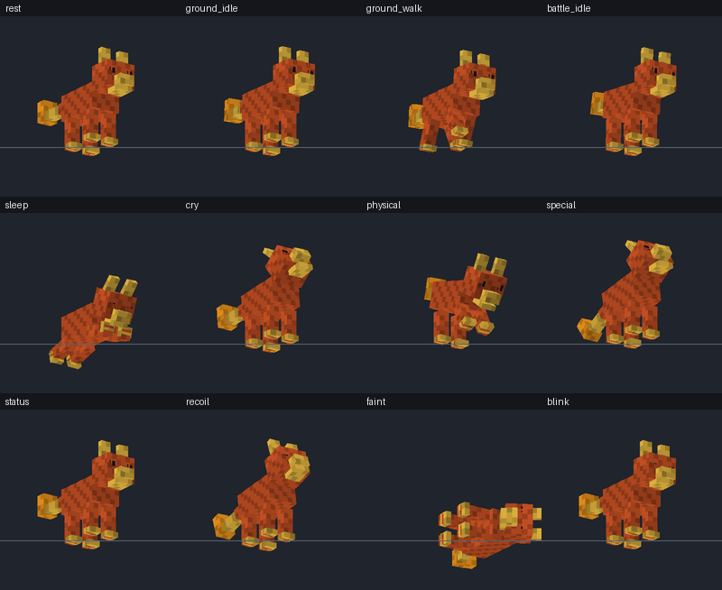
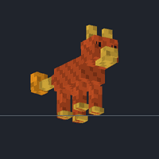
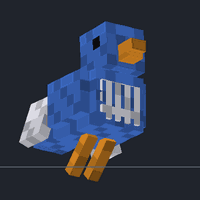

# CobbleEffort

**Plug-and-play custom Pokémon for [Cobblemon](https://cobblemon.com).**
Give it a Blockbench model and a texture. It gives you a working Cobblemon addon with species data,
auto-rigged animations, a poser, a resolver, a shiny texture, lang entries and spawns, packaged as a
**drop-in mod jar** (Fabric + NeoForge) plus a datapack and a resourcepack.



| Auto-generated walk cycle | Auto-generated flight (wing bones detected) |
|---|---|
|  |  |

*Every animation above was generated from the bone names alone. The previews are rendered by
`cobbleeffort preview`.*

---

## The 5-minute version

1. Install **Python 3.9+** ([python.org](https://www.python.org/downloads/)). Optional: `pip install pillow` for GIF previews.
2. Make your Pokémon in Blockbench (**Bedrock Entity** format) and save the `.bbmodel`.
   The texture can stay embedded in the file. Name the bones sensibly (see [Bone names](#bone-names)).
3. **Drag the `.bbmodel` onto `CobbleEffort.bat`** (Windows), or run `./CobbleEffort.sh model.bbmodel`
   (Linux) / `CobbleEffort.command` (macOS).
4. Answer the prompts: name, type(s), movement style, and what it evolves into (Enter accepts the default).
5. Copy `CobbleEffort_Addon/build/<Name>-1.0.0.jar` into your `mods` folder next to Cobblemon. Launch, then run
   `/pokespawn <namespace>:<name>` (add `shiny=yes` to see the shiny).

Building takes about a second. Your time goes into answering a few prompts and, if you want, tweaking `pokemon.json`.

## What gets automated

| Tedious part | What CobbleEffort does |
|---|---|
| Exporting the model | Converts `.bbmodel` to Bedrock `.geo.json` the same way Blockbench's exporter does (pivots, rotations, box and per-face UVs, mirroring, locators). If there are several top-level bones, it wraps them in one root bone. |
| Textures | Pulls embedded textures out of the `.bbmodel`. Picks up `name.png`, `name_shiny.png`, `name_emissive.png` (glow layer) and `name_female.png` automatically. |
| **Shinies** | If there is no `_shiny.png`, it makes one by hue shift (default), by exact palette swap, or with saturation/brightness tweaks. Emissive and female textures get shiny versions too. |
| **Bones & animations** | Detects head, neck, jaw, eyes, legs (biped/quadruped/multi-legged), arms, wings, fins, tail chains, ears and "floppy bits", then generates `ground_idle`, `ground_walk`, `battle_idle`, `sleep`, `blink`, `cry`, `physical`, `special`, `status`, `recoil`, `faint`, plus `air_idle`/`air_fly` for fliers and `water_idle`/`water_swim` for swimmers. Looping animations are written as seamless Molang. Animations you made yourself always take priority. |
| Poser | Maps poses (stand, walk, sleep, battle, hover, fly, float, swim, shoulder, portrait, profile) to the right animations, with head tracking, blink quirks and pitch tilt while flying. Portrait framing is worked out from the model's size. |
| **Evolutions** | One line each: `"blazehound @ level 32"`, `"x @ item fire_stone"`, `"y @ friendship 160 + time night"`, `"z @ trade holding metal_coat"`. Evolutions inside the project are linked both ways (`preEvolution`), get dex numbers in chain order, and inherit types, abilities and moves from their pre-evolution. Stat totals scale with stage. |
| Species data | Stats as a list, a dict, or just a total plus a spread preset. Default abilities and a learnset based on type. Hitbox, height and weight come from the model. Behaviour depends on the archetype (walker, flier, swimmer, floater, amphibian), which is detected from the bones if you don't set it. |
| Spawns | `"biomes": ["forest"]` becomes `#cobblemon:is_forest`. You can also set rarity, levels, time, weather and sky. Evolved forms don't spawn unless you ask. |
| Packaging | Builds a mod jar (Fabric `fabric.mod.json` + NeoForge `lowcodefml`, no code), a datapack zip, a resourcepack zip and a `BUILD_REPORT.md` that lists exactly what was detected and generated. |

## Project workflow (several Pokémon, evolution lines)

```bash
python -m cobbleeffort init MyAddon --name "My Mons" --namespace mymons
python -m cobbleeffort add MyAddon path/to/emberpup.bbmodel --types fire --evolves-to "blazehound @ level 32"
python -m cobbleeffort add MyAddon path/to/blazehound.bbmodel --types fire/dark
python -m cobbleeffort build MyAddon            # -> MyAddon/build/*.jar, *.zip, BUILD_REPORT.md
python -m cobbleeffort preview MyAddon          # also renders GIFs to MyAddon/build/preview/
python -m cobbleeffort analyze some_model.bbmodel   # just show what the auto-rigger sees
```

(`pip install .` installs a `cobbleeffort` command so you can drop the `python -m`.)

Project layout:

```
MyAddon/
  addon.json                    name, namespace, version, pack formats
  pokemon/
    emberpup/
      emberpup.bbmodel          or emberpup.geo.json
      emberpup.png              optional if embedded in the .bbmodel
      emberpup_shiny.png        optional (auto-generated otherwise)
      emberpup_emissive.png     optional glow layer
      emberpup_female.png       optional female texture
      *.animation.json          optional hand-made animations (kept, generator fills gaps)
      pokemon.json              the friendly config (comments allowed)
  lang_extra.json               optional extra translation keys
  build/                        output
```

A complete working example lives in [`examples/ExampleAddon`](examples/ExampleAddon): a fire pup that evolves into
a fire/dark hound, plus a flying bird. Build it with `python -m cobbleeffort build examples/ExampleAddon`.

## `pokemon.json` cheat sheet

Only `name` and `types` are required. `add` writes a fully commented template for you.

```jsonc
{
  "name": "Emberpup",
  "types": "fire",                       // or "fire/flying" or ["fire", "flying"]
  "dex_entry": "Its tail flame flickers when it is happy.",

  "stats": [45, 60, 40, 55, 45, 70],     // or {"hp":45,"atk":60,...}  or  "bst": 420, "spread": "physical"
  "abilities": ["blaze", "h:flashfire"], // h: = hidden ability
  "moves": {                             // or "auto"
    "1": "tackle, growl", "5": "ember", "18": "flame wheel",
    "egg": ["howl"], "tm": "auto"
  },
  "evolutions": ["blazehound @ level 32"],
  "archetype": "auto",                   // walker | flier | swimmer | floater | amphibian
  "gender": 0.875,                       // or "genderless", "male", "female", "87.5%"
  "drops": ["minecraft:blaze_powder 0-1", "cobblemon:charcoal_stick 5%"],
  "spawn": { "biomes": ["savanna", "#minecraft:is_nether"], "rarity": "uncommon", "levels": "5-25", "time": "day" },
  "shiny": { "hue": 200 },               // or "auto", or {"palette": {"#ff8800": "#3366ff"}, "tolerance": 10}
  "animation": { "energy": 1.0, "speed": 1.0, "skip": [] },
  "rig": { "head": "skull", "tails": ["t1", "t2"] },     // only if a bone was detected wrong
  "poser": { "portrait_scale": 1.8 },                     // party/summary framing tweaks
  "extra": { "lightingData": { "lightLevel": 10, "liquidGlowMode": "LAND" } }  // raw Cobblemon fields
}
```

**Evolution conditions** (join several with `+`): `level N`, `item <id>` / `<x>_stone`, `trade`,
`trade holding <item>`, `friendship N`, `time day|night|dusk|dawn`, `holding <item>`, `move <move>`,
`biome <name or #tag>`, `rain`, `thunder`, `male` / `female`, `learns <move>`, `properties <cobblemon props>`.
Item and biome ids without a namespace default to `cobblemon:`.

**Other shortcuts:** `"spread"` presets are `balanced physical special mixed tank special_tank fast bulky glass_cannon`.
Move names like `"Flame Wheel"` become `flamewheel`. `"spawn": false` turns spawning off.

## Bone names

The auto-rigger reads bone names (camelCase, snake_case and `L`/`R`/`FL`/`BR` suffixes all work) and falls back
to positions when a name gives no side. Good names give good animations:

| Part | Name it something like |
|---|---|
| Root | anything; one top-level bone (it adds one if you have several) |
| Body | `body`, `torso`, `chest`, `hips` |
| Head / neck / jaw | `head`, `neck`, `jaw` / `mouth` / `beak_lower` |
| Eyes (for blinking) | `eye_left`, `eye_right` (bones holding the eye cubes) |
| Legs | `leg_front_left`, `leg_back_right`, `leg_left` + children `knee`, `foot`, `paw` |
| Arms | `arm_left` + `elbow_left`, `hand_left` |
| Wings | `wing_left` + `wing_left_tip` (makes it a flier) |
| Tail | `tail` > `tail2` > `tail3` (chains wave nicely) |
| Fins | `fin_left`, `tail_fin` (no legs + fins = swimmer) |
| Ears / floppy bits | `ear_left`, `antenna`, `leaf`, `hair`, `flame`, `tentacle` ... |
| Ignored | `locator_*`, `hitbox`, `seat` |

Run `cobbleeffort analyze model.bbmodel` to check what it found. Fix any mistake with `"rig"` in `pokemon.json`.

## Making the animations your own

The generated animations are a solid starting point, not a replacement for a hand animator. To polish one:
open the generated `build/unpacked/resourcepack/.../animations/<name>/<name>.animation.json` in Blockbench
together with the model, tweak it, and save it into the Pokémon's folder as `<name>.animation.json`. From then on
your version is used and the generator only fills in whatever is still missing. Animations made directly in the
`.bbmodel` are picked up too. Common names like `idle`, `walk`, `fly`, `attack`, `hurt`, `death` are mapped to
Cobblemon's names automatically. Set `"animation": {"regenerate": true}` to ignore supplied animations.

## Versions

* The output is plain Cobblemon addon data (species, spawn pools, bedrock models/animations/posers/resolvers),
  so it doesn't depend on a specific Minecraft build. The formats match Cobblemon's current source:
  `spawnablePositionType` (1.7+; `context` is also written for 1.6), Molang posers with `q.bedrock(...)`, and resolvers with layers.
* Cobblemon currently targets **Minecraft 1.21.1** (Fabric and NeoForge), so the default pack formats are
  `data 48 / resource 34`, with `max_format` left open so newer game versions still accept the packs. If you play a
  different Minecraft version, change `pack_format` in `addon.json`.
* No compiling is needed. The jar is a resource-only mod: Fabric loads its data and assets through Fabric API,
  which Cobblemon already requires, and NeoForge loads it through `lowcodefml`.

## Development

```bash
python -m unittest discover -s tests          # 21 tests: converter, shorthands, rigging, full build checks
python examples/make_example_models.py        # regenerate the example models
```

Code map: `model.py` (bbmodel/geo loading and conversion) · `rig.py` (bone detection) · `animgen.py` (procedural
animations) · `poser.py` · `species.py` (shorthands to species JSON) · `spawns.py` · `textures.py` (PNG codec,
shiny) · `project.py` (build pipeline and packaging) · `preview.py` (software renderer for GIFs) · `cli.py`.

Pokémon is © Nintendo / Creatures Inc. / GAME FREAK inc. Cobblemon is a fan project; this tool is not affiliated
with either.
